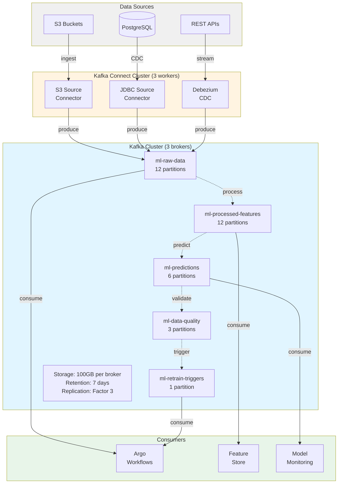
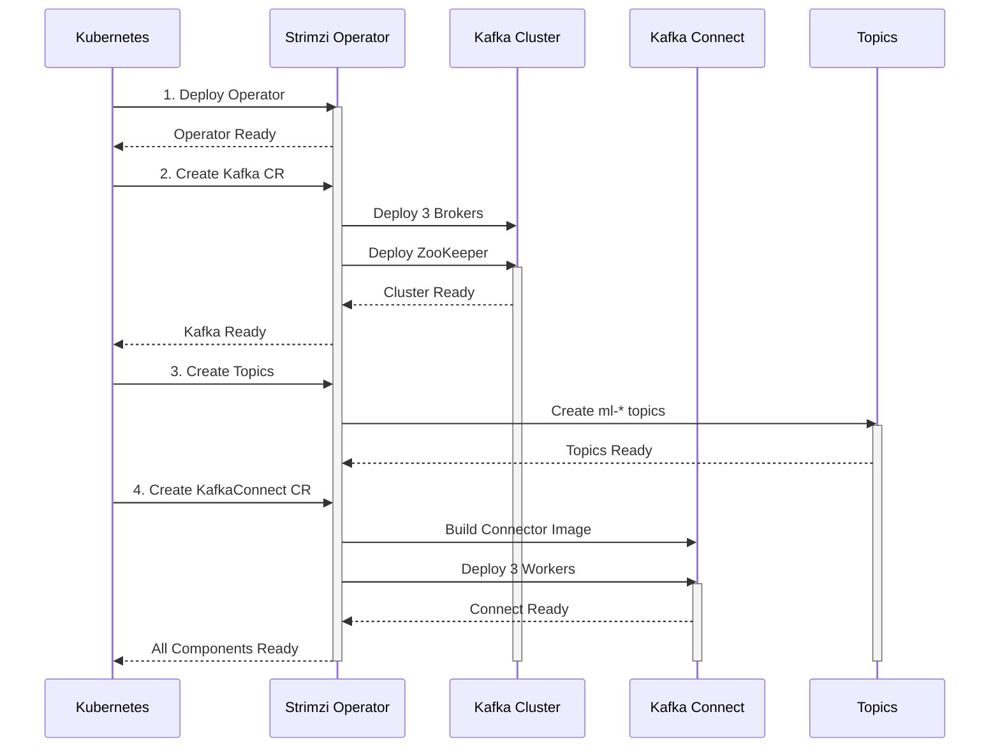

# Setting Up Kafka with Strimzi for ML Data Pipelines

## Overview

This tutorial guides you through deploying a production-ready Kafka cluster using Strimzi for ML data ingestion and streaming. You'll learn how to:

- Deploy Strimzi Kafka Operator on Kubernetes
- Create a 3-broker Kafka cluster optimized for ML workloads
- Configure topics for different pipeline stages
- Set up Kafka Connect for data ingestion
- Monitor Kafka with Prometheus metrics

**Time:** 30 minutes
**Prerequisites:** Kubernetes 1.28+, kubectl, Helm

---

## Why Kafka for ML Pipelines?

**Common Pain Points:**
- 73% of ML teams struggle with real-time data ingestion
- Batch processing creates 2-8 hour delays in model updates
- Data quality issues discovered too late (during training)

**Kafka Solves:**
- ✓ Real-time streaming (< 10ms latency)
- ✓ Decoupled producers/consumers (scale independently)
- ✓ Replay capability (reprocess historical data)
- ✓ Built-in partitioning (parallel processing)

**ML Pipeline Use Cases:**
- Ingest training data from S3, databases, APIs
- Stream-process features before training
- Capture model predictions for monitoring
- Trigger retraining on data quality alerts

---

## Architecture

### Data Flow Overview



### Deployment Sequence



---

## Step 1: Deploy Strimzi Operator

### Install CRDs and Operator

```bash
# Create Kafka namespace
kubectl create namespace kafka

# Install Strimzi Operator (latest stable: 0.43.0)
kubectl create -f 'https://strimzi.io/install/latest?namespace=kafka' -n kafka

# Verify operator is running
kubectl get pods -n kafka -w
# Wait for strimzi-cluster-operator-* to be Running
```

**Alternative:** Use custom operator configuration:

```bash
kubectl apply -f components/01-data-pipeline/strimzi/strimzi-operator.yaml -n kafka
```

### Verify Operator

```bash
# Check operator logs
kubectl logs -n kafka -l name=strimzi-cluster-operator

# Verify CRDs installed
kubectl get crd | grep kafka
# Should see: kafka.kafka.strimzi.io, kafkatopic.kafka.strimzi.io, etc.
```

---

## Step 2: Deploy Kafka Cluster

### Create 3-Broker Cluster

```bash
kubectl apply -f components/01-data-pipeline/strimzi/kafka-cluster.yaml -n kafka
```

**What This Creates:**
- 3 Kafka brokers (StatefulSet)
- 3 ZooKeeper nodes (for Kafka < 3.8)
- Prometheus metrics exporters
- ServiceMonitor for Prometheus Operator

### Monitor Deployment

```bash
# Watch cluster creation (takes 3-5 minutes)
kubectl get kafka -n kafka -w

# Should show: ml-data-cluster  True

# Check pods
kubectl get pods -n kafka
# Should see:
#   ml-data-cluster-kafka-0, -1, -2 (brokers)
#   ml-data-cluster-zookeeper-0, -1, -2
#   ml-data-cluster-entity-operator-*
```

### Verify Cluster Health

```bash
# Get cluster status
kubectl get kafka ml-data-cluster -n kafka -o yaml | grep "type: Ready"

# Check broker logs
kubectl logs -n kafka ml-data-cluster-kafka-0 -c kafka

# Verify Prometheus metrics
kubectl port-forward -n kafka svc/ml-data-cluster-kafka-bootstrap 9092:9092
curl localhost:9092/metrics  # Should return Kafka metrics
```

---

## Step 3: Create ML Pipeline Topics

### Deploy Topic Definitions

```bash
kubectl apply -f components/01-data-pipeline/strimzi/kafka-topics.yaml -n kafka
```

**Topics Created:**

| Topic | Partitions | Retention | Use Case |
|-------|------------|-----------|----------|
| ml-raw-data | 12 | 7 days | Raw training data ingestion |
| ml-processed-features | 12 | 7 days | Preprocessed features |
| ml-predictions | 6 | 30 days | Model predictions (monitoring) |
| ml-data-quality | 3 | 7 days | Data quality metrics |
| ml-feature-updates | 6 | 14 days | Feature store sync (compacted) |
| ml-retrain-triggers | 1 | 7 days | Event-driven retraining |
| ml-dlq | 3 | 30 days | Dead letter queue (debugging) |

### Verify Topics

```bash
# List all topics
kubectl get kafkatopics -n kafka

# Describe specific topic
kubectl describe kafkatopic ml-raw-data -n kafka

# Check topic configuration
kubectl exec -it ml-data-cluster-kafka-0 -n kafka -- \
  bin/kafka-topics.sh --bootstrap-server localhost:9092 --describe --topic ml-raw-data
```

---

## Step 4: Set Up Kafka Connect

### Deploy Kafka Connect Cluster

```bash
kubectl apply -f components/01-data-pipeline/strimzi/kafka-connect.yaml -n kafka
```

**Connectors Included:**
- S3 Source Connector (ingest from S3)
- S3 Sink Connector (backup to S3)
- JDBC Connector (ingest from databases)
- Debezium PostgreSQL CDC (change data capture)

### Monitor Connector Build

```bash
# Watch connector image build (takes 5-10 minutes)
kubectl get kafkaconnect ml-data-connect -n kafka -w

# Check build status
kubectl get kafkaconnect ml-data-connect -n kafka -o jsonpath='{.status.conditions[?(@.type=="Ready")].status}'
# Should return: True
```

### Create S3 Source Connector

**Prerequisites:** AWS credentials in secrets

```bash
# Create AWS credentials secret
kubectl create secret generic aws-credentials -n kafka \
  --from-literal=access-key-id=YOUR_ACCESS_KEY \
  --from-literal=secret-access-key=YOUR_SECRET_KEY

# Apply S3 source connector (already in kafka-connect.yaml)
# Or create custom connector:
kubectl apply -f - <<EOF
apiVersion: kafka.strimzi.io/v1beta2
kind: KafkaConnector
metadata:
  name: s3-source-ml-data
  namespace: kafka
  labels:
    strimzi.io/cluster: ml-data-connect
spec:
  class: io.confluent.connect.s3.source.S3SourceConnector
  tasksMax: 6
  config:
    s3.bucket.name: "ml-training-data"
    s3.region: "us-west-2"
    aws.access.key.id: "\${env:AWS_ACCESS_KEY_ID}"
    aws.secret.access.key: "\${env:AWS_SECRET_ACCESS_KEY}"
    format.class: "io.confluent.connect.s3.format.json.JsonFormat"
    topics.dir: "raw-data"
    kafka.topic: "ml-raw-data"
    poll.interval.ms: "5000"
    errors.tolerance: "all"
    errors.log.enable: "true"
    errors.deadletterqueue.topic.name: "ml-dlq"
EOF
```

### Verify Connector

```bash
# Check connector status
kubectl get kafkaconnector -n kafka

# Get connector details
kubectl describe kafkaconnector s3-source-ml-data -n kafka

# Check tasks running
kubectl exec -it ml-data-connect-connect-0 -n kafka -- \
  curl -s localhost:8083/connectors/s3-source-ml-data/status | jq
```

---

## Step 5: Test Data Flow

### Produce Test Messages

```bash
# Run Kafka console producer
kubectl run -it --rm kafka-producer \
  --image=quay.io/strimzi/kafka:latest-kafka-3.7.0 \
  --restart=Never -n kafka -- \
  bin/kafka-console-producer.sh \
  --bootstrap-server ml-data-cluster-kafka-bootstrap:9092 \
  --topic ml-raw-data

# Type messages (JSON format):
{"id": 1, "timestamp": "2024-01-01T00:00:00Z", "features": {"age": 25, "income": 50000}}
{"id": 2, "timestamp": "2024-01-01T00:01:00Z", "features": {"age": 35, "income": 75000}}
# Press Ctrl+D to exit
```

### Consume Messages

```bash
# Run Kafka console consumer
kubectl run -it --rm kafka-consumer \
  --image=quay.io/strimzi/kafka:latest-kafka-3.7.0 \
  --restart=Never -n kafka -- \
  bin/kafka-console-consumer.sh \
  --bootstrap-server ml-data-cluster-kafka-bootstrap:9092 \
  --topic ml-raw-data \
  --from-beginning

# Should see messages you produced
# Press Ctrl+C to exit
```

---

## Step 6: Monitor with Prometheus

### Deploy Prometheus (if not already installed)

```bash
helm repo add prometheus-community https://prometheus-community.github.io/helm-charts
helm install prometheus prometheus-community/kube-prometheus-stack -n monitoring --create-namespace
```

### Verify Kafka Metrics

```bash
# Port-forward to Prometheus
kubectl port-forward -n monitoring svc/prometheus-kube-prometheus-prometheus 9090:9090

# Open http://localhost:9090
# Query examples:
#   kafka_server_broker_topic_metrics_bytesinpersec
#   kafka_server_replica_manager_under_replicated_partitions
#   kafka_server_broker_topic_metrics_messagesInPerSec{topic="ml-raw-data"}
```

### Kafka Metrics Dashboard

**Key Metrics to Monitor:**

| Metric | Alert Threshold | Meaning |
|--------|----------------|---------|
| `kafka_server_replica_manager_under_replicated_partitions` | > 0 | Data loss risk |
| `kafka_server_broker_topic_metrics_bytesinpersec` | > 100 MB/s | High throughput |
| `kafka_controller_offline_partitions_count` | > 0 | Partitions unavailable |
| `kafka_network_request_metrics_requestsPerSec` | > 10k | High load |

---

## Common Issues & Troubleshooting

### Issue 1: Pods Stuck in Pending

**Symptom:**
```bash
kubectl get pods -n kafka
# ml-data-cluster-kafka-0  0/1  Pending
```

**Cause:** PersistentVolumeClaim not bound (missing storage class)

**Fix:**
```bash
# Check storage class exists
kubectl get storageclass

# If missing, create one (GKE example):
kubectl apply -f - <<EOF
apiVersion: storage.k8s.io/v1
kind: StorageClass
metadata:
  name: fast-ssd
provisioner: kubernetes.io/gce-pd
parameters:
  type: pd-ssd
EOF

# Update kafka-cluster.yaml storage.class: fast-ssd
```

### Issue 2: Kafka Connect Build Fails

**Symptom:**
```bash
kubectl logs -n kafka ml-data-connect-connect-build-1-xxxxx
# Error downloading connector from URL
```

**Cause:** Network issues or invalid connector URL

**Fix:**
```bash
# Use Strimzi Kafka image with pre-built connectors
# Or build custom image with connectors included
```

### Issue 3: Messages Not Consumed

**Symptom:** Producer works, consumer receives no messages

**Cause:** Consumer group offset too far ahead

**Fix:**
```bash
# Reset consumer group offset
kubectl exec -it ml-data-cluster-kafka-0 -n kafka -- \
  bin/kafka-consumer-groups.sh \
  --bootstrap-server localhost:9092 \
  --group my-consumer-group \
  --reset-offsets \
  --to-earliest \
  --topic ml-raw-data \
  --execute
```

---

## Performance Tuning for ML Workloads

### Optimize Throughput

**For Large Training Datasets:**

```yaml
# In kafka-cluster.yaml
config:
  num.io.threads: 16  # Increase for high disk I/O
  num.network.threads: 8  # Increase for high network throughput
  socket.send.buffer.bytes: 102400  # 100KB
  socket.receive.buffer.bytes: 102400
  socket.request.max.bytes: 104857600  # 100MB (for large messages)

  # Increase batch size for better compression
  compression.type: snappy  # Fast compression
  batch.size: 1048576  # 1MB batches
```

### Optimize Latency

**For Real-Time Inference:**

```yaml
# In kafka-topics.yaml (ml-predictions topic)
config:
  min.insync.replicas: 1  # Reduce to 1 for faster writes
  compression.type: none  # Disable compression
  retention.ms: 86400000  # 1 day (shorter retention)
```

---

## Production Checklist

- [  ] Enable TLS encryption for in-cluster communication
- [  ] Configure SASL authentication for Kafka clients
- [  ] Set up monitoring alerts for under-replicated partitions
- [  ] Configure backup/restore with Kafka Connect S3 sink
- [  ] Enable quotas to prevent topic abuse
- [  ] Document topic naming conventions
- [  ] Set up log aggregation for Kafka brokers
- [  ] Test disaster recovery (broker failure scenarios)

---

## Common Pitfalls

### 1. Under-Provisioned Disk Storage

**Mistake:** Using default storage (10GB) for Kafka brokers in production.

**Impact:** Brokers run out of disk → data loss, cluster unavailable.

**Solution:**
```yaml
# In kafka-cluster.yaml
storage:
  type: persistent-claim
  size: 100Gi  # Minimum for ML workloads
  class: fast-ssd  # Use SSD for better IOPS
```

**Rule of Thumb:**
- Development: 20-50GB per broker
- Production: 100-500GB per broker
- Calculate: (messages/day × message_size × retention_days) / replication_factor / num_brokers

### 2. Wrong Partition Count

**Mistake:** Creating topics with 1-3 partitions for high-throughput ML data.

**Impact:** Poor parallelism, slow data ingestion, consumer bottlenecks.

**Solution:**
```bash
# Calculate partitions based on throughput target
# Target: 1000 MB/s, single partition max: 100 MB/s
# Partitions needed: 1000 / 100 = 10 partitions minimum

# For ML data ingestion, start with:
# - Training data topics: 12 partitions (matches typical pod count)
# - Prediction topics: 6 partitions (lower throughput)
# - Trigger topics: 1 partition (order matters)
```

**Warning:** You can add partitions later, but not remove them!

### 3. Not Setting Retention Policies

**Mistake:** Using default retention (7 days) for all topics.

**Impact:** Either wasted storage or accidental data deletion.

**Solution:**
```yaml
# Different retention for different use cases:
spec:
  config:
    # Training data (replayable)
    ml-raw-data:
      retention.ms: 604800000  # 7 days

    # Predictions (for monitoring)
    ml-predictions:
      retention.ms: 2592000000  # 30 days

    # Feature updates (compacted - keep latest)
    ml-feature-updates:
      cleanup.policy: compact
      min.compaction.lag.ms: 86400000  # 1 day
```

### 4. Ignoring Consumer Group Lag

**Mistake:** Not monitoring consumer lag in ML pipelines.

**Impact:** Stale features, delayed training, missed retraining triggers.

**Solution:**
```bash
# Monitor consumer lag
kubectl exec -it ml-data-cluster-kafka-0 -n kafka -- \
  bin/kafka-consumer-groups.sh \
  --bootstrap-server localhost:9092 \
  --describe --group ml-training-consumer

# Alert when lag > 100k messages or lag time > 5 minutes
```

**Best Practice:** Set up Prometheus alerts for consumer lag.

### 5. Running Without Replication

**Mistake:** Setting `replicas: 1` or `min.insync.replicas: 1` for critical topics.

**Impact:** Data loss on broker failure, no high availability.

**Solution:**
```yaml
# In kafka-cluster.yaml (cluster level)
config:
  default.replication.factor: 3
  min.insync.replicas: 2  # At least 2 replicas must ack

# Per topic (critical data)
spec:
  replicas: 3
  config:
    min.insync.replicas: 2
```

**Warning:** With `min.insync.replicas: 2` and only 2 brokers total, losing 1 broker makes topic unavailable!

### 6. Not Using Dead Letter Queues

**Mistake:** Setting `errors.tolerance: none` or not handling bad messages.

**Impact:** One malformed message stops entire pipeline.

**Solution:**
```yaml
# In Kafka Connect connector config
config:
  errors.tolerance: all
  errors.log.enable: true
  errors.deadletterqueue.topic.name: ml-dlq
  errors.deadletterqueue.topic.replication.factor: 3
```

**Monitor:** Check DLQ topic daily for data quality issues.

### 7. Hardcoding Bootstrap Servers

**Mistake:**
```python
# Bad: Hardcoded hostname
producer = KafkaProducer(
    bootstrap_servers=['ml-data-cluster-kafka-0.kafka.svc.cluster.local:9092']
)
```

**Impact:** Breaks when broker restarts with new IP or hostname changes.

**Solution:**
```python
# Good: Use service DNS name
producer = KafkaProducer(
    bootstrap_servers=['ml-data-cluster-kafka-bootstrap.kafka.svc.cluster.local:9092']
)

# Better: Use environment variable
import os
producer = KafkaProducer(
    bootstrap_servers=os.getenv('KAFKA_BOOTSTRAP_SERVERS').split(',')
)
```

### 8. Skipping Schema Management

**Mistake:** Sending arbitrary JSON without schema validation.

**Impact:** Downstream consumers break on schema changes, data quality issues.

**Solution:**
```yaml
# Use Apicurio Schema Registry (future enhancement)
# For now: Document schema in topic description
spec:
  topicName: ml-raw-data
  config:
    # Schema: {"id": int, "timestamp": ISO8601, "features": {...}}
    # Breaking changes require new topic version: ml-raw-data-v2
```

**Best Practice:** Version your message schemas, never make breaking changes to existing topics.

---

## Next Steps

- **Tutorial 02:** [Argo Workflows Basics](02-workflow-basics.md) - Build data pipelines
- **Tutorial 03:** [Data Validation](03-data-validation.md) - Ensure data quality
- **Example:** [End-to-End Pipeline](../../examples/end-to-end-pipeline.yaml) - See Kafka in action

---

## Resources

- [Strimzi Documentation](https://strimzi.io/docs/operators/latest/overview.html)
- [Kafka Connect Connectors](https://www.confluent.io/hub/)
- [Kafka Performance Tuning](https://kafka.apache.org/documentation/#brokerconfigs)
