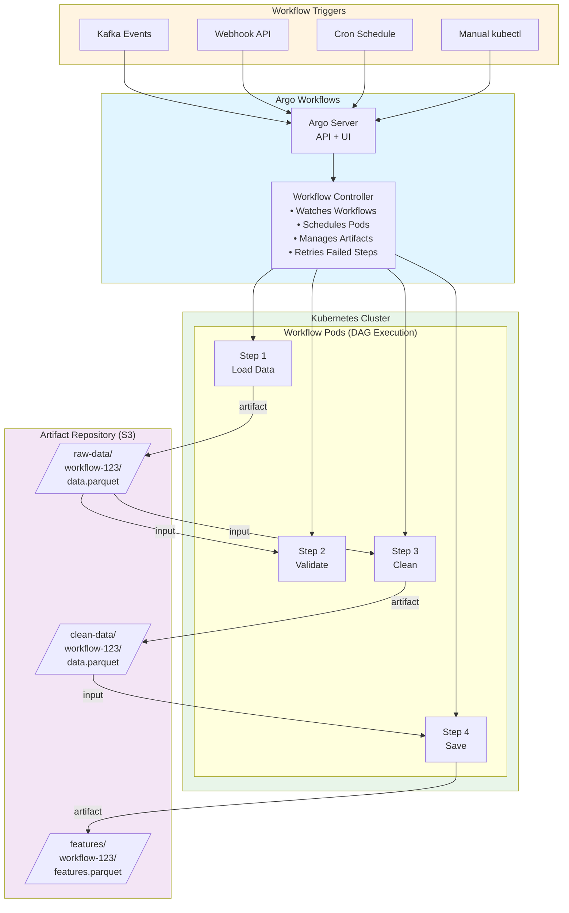
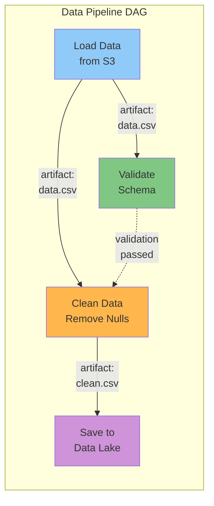
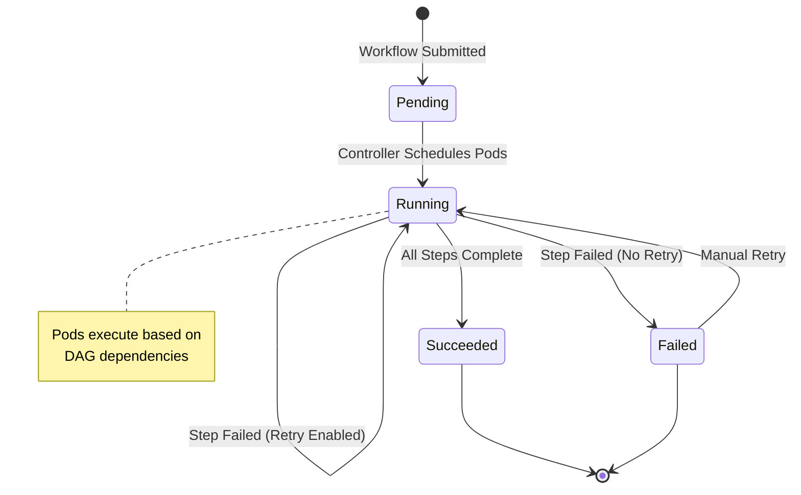

# Argo Workflows Basics for ML Pipelines

## Overview

This tutorial introduces Argo Workflows for orchestrating ML data pipelines on Kubernetes. You'll learn how to:

- Deploy Argo Workflows on Kubernetes
- Create DAG-based data processing workflows
- Pass artifacts between steps (S3, volumes)
- Handle retries and error handling
- Trigger workflows with events (Kafka, webhooks, cron)

**Time:** 45 minutes
**Prerequisites:** Kubernetes cluster, kubectl, Kafka cluster running

---

## Why Argo Workflows for ML?

**Common Pain Points:**
- 67% of ML projects struggle with orchestration
- Batch scripts fail silently (no visibility)
- No dependency management (steps run in wrong order)
- Manual retries waste engineering time

**Argo Workflows Solves:**
- ✓ DAG-based execution (dependencies enforced)
- ✓ Native Kubernetes integration (GPU scheduling)
- ✓ Automatic retries with backoff
- ✓ Artifact passing (parquet files, models)
- ✓ UI for monitoring (real-time progress)

**ML Pipeline Use Cases:**
- Data preprocessing (clean → transform → validate)
- Feature engineering (scale → encode → select)
- Model training (hyperparameter tuning, cross-validation)
- Model deployment (build → test → promote)

---

## Architecture

### System Overview



### DAG Execution Flow



### Workflow Lifecycle



---

## Step 1: Install Argo Workflows

### Deploy Argo Server and Controller

```bash
# Create Argo namespace
kubectl create namespace argo

# Install Argo Workflows (v3.5.5 latest stable)
kubectl apply -n argo -f https://github.com/argoproj/argo-workflows/releases/download/v3.5.5/install.yaml

# Wait for pods to be ready
kubectl get pods -n argo -w
```

### Configure Artifact Repository (S3)

**Create S3 bucket (AWS example):**

```bash
# Create S3 bucket for workflow artifacts
aws s3 mb s3://ml-pipeline-artifacts --region us-west-2

# Create IAM role for Argo (IRSA - IAM Roles for Service Accounts)
# See: https://docs.aws.amazon.com/eks/latest/userguide/iam-roles-for-service-accounts.html
```

**Configure Argo to use S3:**

```bash
kubectl edit configmap workflow-controller-configmap -n argo
```

Add artifact repository config:

```yaml
data:
  artifactRepository: |
    s3:
      bucket: ml-pipeline-artifacts
      region: us-west-2
      endpoint: s3.amazonaws.com
      useSDKCreds: true  # Use IAM roles
```

### Access Argo UI

```bash
# Port-forward to Argo Server
kubectl -n argo port-forward svc/argo-server 2746:2746

# Open https://localhost:2746 in browser
# Username: admin
# Password: (from secret, or use --auth-mode=server for no auth in dev)
```

---

## Step 2: Your First Workflow

### Hello World Example

Create `hello-world.yaml`:

```yaml
apiVersion: argoproj.io/v1alpha1
kind: Workflow
metadata:
  generateName: hello-world-
  namespace: argo
spec:
  entrypoint: hello
  templates:
    - name: hello
      container:
        image: python:3.11-slim
        command: [python]
        args:
          - -c
          - |
            print("Hello from Argo Workflows!")
            print("This is step 1 of your ML pipeline")
```

**Submit workflow:**

```bash
kubectl create -f hello-world.yaml -n argo

# Watch workflow
kubectl get workflows -n argo -w

# View logs
kubectl logs -n argo <workflow-pod-name>
```

---

## Step 3: DAG Workflow (Dependencies)

### Multi-Step Data Pipeline

Create `data-pipeline-dag.yaml`:

```yaml
apiVersion: argoproj.io/v1alpha1
kind: Workflow
metadata:
  generateName: data-pipeline-
  namespace: argo
spec:
  entrypoint: pipeline-dag

  templates:
    # DAG definition
    - name: pipeline-dag
      dag:
        tasks:
          # Step 1: Load data
          - name: load-data
            template: load

          # Step 2: Validate (depends on load-data)
          - name: validate-data
            dependencies: [load-data]
            template: validate
            arguments:
              artifacts:
                - name: input-data
                  from: "{{tasks.load-data.outputs.artifacts.dataset}}"

          # Step 3: Clean (depends on validate-data)
          - name: clean-data
            dependencies: [validate-data]
            template: clean
            arguments:
              artifacts:
                - name: input-data
                  from: "{{tasks.load-data.outputs.artifacts.dataset}}"

          # Step 4: Save (depends on clean-data)
          - name: save-data
            dependencies: [clean-data]
            template: save
            arguments:
              artifacts:
                - name: clean-data
                  from: "{{tasks.clean-data.outputs.artifacts.output}}"

    # Template: Load data
    - name: load
      outputs:
        artifacts:
          - name: dataset
            path: /tmp/data.csv
            s3:
              key: "raw-data/{{workflow.name}}/data.csv"
      container:
        image: python:3.11-slim
        command: [sh, -c]
        args:
          - |
            echo "id,value" > /tmp/data.csv
            echo "1,100" >> /tmp/data.csv
            echo "2,200" >> /tmp/data.csv
            echo "3,300" >> /tmp/data.csv
            echo "Loaded 3 records"

    # Template: Validate
    - name: validate
      inputs:
        artifacts:
          - name: input-data
            path: /tmp/input.csv
      container:
        image: python:3.11-slim
        command: [sh, -c]
        args:
          - |
            lines=$(wc -l < /tmp/input.csv)
            echo "Validating $lines lines"
            if [ $lines -lt 2 ]; then
              echo "ERROR: Not enough data"
              exit 1
            fi
            echo "Validation passed"

    # Template: Clean
    - name: clean
      inputs:
        artifacts:
          - name: input-data
            path: /tmp/input.csv
      outputs:
        artifacts:
          - name: output
            path: /tmp/output.csv
            s3:
              key: "clean-data/{{workflow.name}}/data.csv"
      container:
        image: python:3.11-slim
        command: [sh, -c]
        args:
          - |
            # Remove duplicates, handle missing values, etc.
            cp /tmp/input.csv /tmp/output.csv
            echo "Cleaned data"

    # Template: Save
    - name: save
      inputs:
        artifacts:
          - name: clean-data
            path: /tmp/clean.csv
      container:
        image: python:3.11-slim
        command: [sh, -c]
        args:
          - |
            echo "Saving clean data to data lake..."
            cat /tmp/clean.csv
            echo "Done!"
```

**Submit and monitor:**

```bash
kubectl create -f data-pipeline-dag.yaml -n argo

# Watch in UI: https://localhost:2746
# Or CLI:
kubectl get workflows -n argo
kubectl logs -n argo <pod-name>
```

---

## Step 4: Artifact Passing (Parquet Files)

### Real ML Data Pipeline

Create `ml-preprocessing.yaml`:

```yaml
apiVersion: argoproj.io/v1alpha1
kind: Workflow
metadata:
  generateName: ml-preprocessing-
  namespace: argo
spec:
  entrypoint: main

  templates:
    - name: main
      dag:
        tasks:
          - name: generate
            template: generate-data

          - name: preprocess
            dependencies: [generate]
            template: preprocess-data
            arguments:
              artifacts:
                - name: raw-data
                  from: "{{tasks.generate.outputs.artifacts.raw-parquet}}"

    # Generate sample data
    - name: generate-data
      outputs:
        artifacts:
          - name: raw-parquet
            path: /data/raw.parquet
            s3:
              key: "ml-data/{{workflow.name}}/raw.parquet"
      container:
        image: python:3.11-slim
        command: [sh, -c]
        args:
          - |
            pip install -q pandas pyarrow numpy
            python3 << 'EOF'
            import pandas as pd
            import numpy as np

            np.random.seed(42)
            df = pd.DataFrame({
                'feature_1': np.random.randn(1000),
                'feature_2': np.random.randn(1000),
                'target': np.random.randint(0, 2, 1000)
            })

            df.to_parquet('/data/raw.parquet', index=False)
            print(f"Generated {len(df)} samples")
            EOF

    # Preprocess data
    - name: preprocess-data
      inputs:
        artifacts:
          - name: raw-data
            path: /data/raw.parquet
      outputs:
        artifacts:
          - name: processed-parquet
            path: /data/processed.parquet
            s3:
              key: "ml-data/{{workflow.name}}/processed.parquet"
      container:
        image: python:3.11-slim
        command: [sh, -c]
        args:
          - |
            pip install -q pandas pyarrow scikit-learn
            python3 << 'EOF'
            import pandas as pd
            from sklearn.preprocessing import StandardScaler

            df = pd.read_parquet('/data/raw.parquet')

            # Scale features
            scaler = StandardScaler()
            df[['feature_1', 'feature_2']] = scaler.fit_transform(
                df[['feature_1', 'feature_2']]
            )

            df.to_parquet('/data/processed.parquet', index=False)
            print(f"Preprocessed {len(df)} samples")
            EOF
```

---

## Step 5: Retry Strategies

### Handle Transient Failures

```yaml
apiVersion: argoproj.io/v1alpha1
kind: Workflow
metadata:
  generateName: retry-example-
  namespace: argo
spec:
  entrypoint: unreliable-step

  templates:
    - name: unreliable-step
      retryStrategy:
        limit: 3  # Retry up to 3 times
        retryPolicy: "Always"  # Retry on any error
        backoff:
          duration: "1m"  # Initial backoff
          factor: 2  # Exponential backoff (1m, 2m, 4m)
          maxDuration: "10m"  # Max backoff
      container:
        image: python:3.11-slim
        command: [sh, -c]
        args:
          - |
            # Simulate random failures
            if [ $((RANDOM % 2)) -eq 0 ]; then
              echo "Failed!"
              exit 1
            fi
            echo "Success!"
```

---

## Step 6: WorkflowTemplates (Reusable)

### Create Library of Templates

Create `preprocessing-library.yaml`:

```yaml
apiVersion: argoproj.io/v1alpha1
kind: WorkflowTemplate
metadata:
  name: preprocessing-library
  namespace: argo
spec:
  templates:
    # Reusable: Scale features
    - name: scale-features
      inputs:
        artifacts:
          - name: input-data
            path: /data/input.parquet
      outputs:
        artifacts:
          - name: scaled-data
            path: /data/output.parquet
      container:
        image: python:3.11-slim
        command: [sh, -c]
        args:
          - |
            pip install -q pandas pyarrow scikit-learn
            python3 << 'EOF'
            import pandas as pd
            from sklearn.preprocessing import StandardScaler

            df = pd.read_parquet('/data/input.parquet')
            scaler = StandardScaler()

            numerical_cols = df.select_dtypes(include=['float64', 'int64']).columns
            df[numerical_cols] = scaler.fit_transform(df[numerical_cols])

            df.to_parquet('/data/output.parquet', index=False)
            EOF
```

**Use template in workflow:**

```yaml
apiVersion: argoproj.io/v1alpha1
kind: Workflow
metadata:
  generateName: use-template-
  namespace: argo
spec:
  entrypoint: main
  templates:
    - name: main
      steps:
        - - name: scale
            templateRef:
              name: preprocessing-library
              template: scale-features
            arguments:
              artifacts:
                - name: input-data
                  s3:
                    key: "raw-data/sample.parquet"
```

---

## Step 7: Event-Driven Workflows

### Trigger on Kafka Events

**Install Argo Events:**

```bash
kubectl apply -f https://raw.githubusercontent.com/argoproj/argo-events/stable/manifests/install.yaml
```

**Create Kafka Event Source:**

```yaml
apiVersion: argoproj.io/v1alpha1
kind: EventSource
metadata:
  name: kafka-source
  namespace: argo
spec:
  kafka:
    ml-raw-data:
      url: ml-data-cluster-kafka-bootstrap.kafka.svc.cluster.local:9092
      topic: ml-raw-data
      partition: "0"
      consumerGroup:
        groupName: argo-triggers
```

**Create Sensor (Workflow Trigger):**

```yaml
apiVersion: argoproj.io/v1alpha1
kind: Sensor
metadata:
  name: kafka-sensor
  namespace: argo
spec:
  dependencies:
    - name: kafka-dep
      eventSourceName: kafka-source
      eventName: ml-raw-data
  triggers:
    - template:
        name: trigger-workflow
        k8s:
          operation: create
          source:
            resource:
              apiVersion: argoproj.io/v1alpha1
              kind: Workflow
              metadata:
                generateName: auto-preprocessing-
              spec:
                entrypoint: main
                templates:
                  - name: main
                    container:
                      image: python:3.11-slim
                      command: [echo, "Processing Kafka event"]
```

---

## Common Patterns

### Pattern 1: Parallel Execution

```yaml
dag:
  tasks:
    # Run validation and stats in parallel
    - name: validate
      template: validate-schema
    - name: stats
      template: calculate-stats

    # Wait for both to finish
    - name: report
      dependencies: [validate, stats]
      template: generate-report
```

### Pattern 2: Conditional Steps

```yaml
- name: check-quality
  template: quality-check

- name: retrain
  template: trigger-training
  when: "{{tasks.check-quality.outputs.result}} == 'FAIL'"
```

### Pattern 3: Looping (Map)

```yaml
- name: process-files
  template: process-file
  arguments:
    parameters:
      - name: file
        value: "{{item}}"
  withItems:
    - file1.parquet
    - file2.parquet
    - file3.parquet
```

---

## Monitoring & Debugging

### View Workflow Status

```bash
# List workflows
kubectl get workflows -n argo

# Describe workflow
kubectl describe workflow <workflow-name> -n argo

# View logs
kubectl logs -n argo <pod-name>

# Get workflow YAML (for debugging)
kubectl get workflow <workflow-name> -n argo -o yaml
```

### Argo UI

- **DAG view:** Visualize workflow graph
- **Logs:** Real-time logs per step
- **Artifacts:** Download outputs
- **Metrics:** Duration, success rate

---

## Production Best Practices

1. **Resource Limits:** Set CPU/memory limits on all containers
2. **Retries:** Use retry strategies for network calls
3. **Timeouts:** Set `activeDeadlineSeconds` to prevent runaway jobs
4. **Cleanup:** Enable `podGC` to delete completed pods
5. **Secrets:** Use Kubernetes secrets for credentials
6. **Monitoring:** Export metrics to Prometheus
7. **Archiving:** Configure TTL for workflow cleanup

---

## Common Pitfalls

### 1. Missing Artifact Repository Configuration

**Mistake:** Deploying Argo without configuring S3/artifact storage.

**Impact:** Workflows fail with "artifact repository not configured" error.

**Solution:**
```bash
# Configure in workflow-controller-configmap
kubectl edit configmap workflow-controller-configmap -n argo

# Add:
data:
  artifactRepository: |
    s3:
      bucket: ml-pipeline-artifacts
      region: us-west-2
      endpoint: s3.amazonaws.com
      useSDKCreds: true
```

**Alternative:** Use PVC-based artifacts for single-cluster setups:
```yaml
artifactRepository: |
  archiveLogs: true
  pvc:
    name: workflow-artifacts
    accessMode: ReadWriteMany
```

### 2. Circular Dependencies in DAG

**Mistake:**
```yaml
dag:
  tasks:
    - name: step-a
      dependencies: [step-b]
    - name: step-b
      dependencies: [step-a]  # ❌ Circular!
```

**Impact:** Workflow never starts, stuck in "Pending" state.

**Solution:**
- Use `kubectl describe workflow <name>` to identify circular deps
- Draw DAG on paper before writing YAML
- Steps with no dependencies run first

### 3. Not Setting Resource Limits

**Mistake:**
```yaml
container:
  image: python:3.11-slim
  # ❌ No resources defined!
```

**Impact:** Workflow pods evict other workloads, cluster instability.

**Solution:**
```yaml
container:
  image: python:3.11-slim
  resources:
    requests:
      memory: "2Gi"
      cpu: "1000m"
    limits:
      memory: "4Gi"
      cpu: "2000m"
```

**ML Workload Guidelines:**
- Data preprocessing: 2-4 GB RAM
- Training (small models): 8-16 GB RAM + 1 GPU
- Training (large models): 32-64 GB RAM + 2-4 GPUs

### 4. Installing Dependencies in Every Step

**Mistake:**
```yaml
container:
  image: python:3.11-slim
  command: [sh, -c]
  args:
    - |
      pip install pandas numpy scikit-learn  # ⚠️ Slow!
      python train.py
```

**Impact:** Wastes 2-5 minutes per step installing same packages.

**Solution:**
```dockerfile
# Build custom image with dependencies
FROM python:3.11-slim
RUN pip install pandas numpy scikit-learn pyarrow boto3
COPY train.py /app/
WORKDIR /app
```

```yaml
# Use pre-built image
container:
  image: myregistry/ml-pipeline:v1.0
  command: [python, train.py]
```

### 5. Ignoring Workflow Cleanup

**Mistake:** Not setting TTL or pod GC, accumulating completed workflows.

**Impact:** etcd storage fills up, cluster performance degrades.

**Solution:**
```yaml
# In workflow spec
spec:
  ttlStrategy:
    secondsAfterCompletion: 86400  # Delete after 24 hours
    secondsAfterSuccess: 3600      # Success: 1 hour
    secondsAfterFailure: 604800    # Failure: 7 days (debug)

  podGC:
    strategy: OnWorkflowSuccess  # Delete pods after success
```

**Global Config:**
```bash
kubectl edit configmap workflow-controller-configmap -n argo

# Add:
data:
  retentionPolicy: |
    completed: 7
    failed: 30
    errored: 30
```

### 6. Not Using `when` Conditions Properly

**Mistake:**
```yaml
- name: train-model
  template: training
- name: deploy-model
  dependencies: [train-model]
  # ❌ Deploys even if training failed!
```

**Impact:** Deploying untrained or failed models to production.

**Solution:**
```yaml
- name: train-model
  template: training
- name: deploy-model
  dependencies: [train-model]
  when: "{{tasks.train-model.status}} == Succeeded"  # ✓ Conditional
```

**Advanced:** Check output values:
```yaml
- name: evaluate-model
  template: evaluate
- name: deploy-model
  when: "{{tasks.evaluate-model.outputs.parameters.accuracy}} > 0.9"
```

### 7. Hardcoding S3 Keys

**Mistake:**
```yaml
artifacts:
  - name: data
    path: /data/input.parquet
    s3:
      key: "ml-data/2024-01-15/data.parquet"  # ❌ Hardcoded date!
```

**Impact:** Workflows fail when date changes, not reusable.

**Solution:**
```yaml
# Use workflow variables
artifacts:
  - name: data
    path: /data/input.parquet
    s3:
      key: "ml-data/{{workflow.name}}/{{workflow.parameters.date}}/data.parquet"

# Pass as parameter
spec:
  arguments:
    parameters:
      - name: date
        value: "{{workflow.creationTimestamp}}"
```

### 8. Not Handling Large Artifacts

**Mistake:** Passing 10GB datasets as Kubernetes artifacts.

**Impact:** Slow uploads/downloads, S3 costs, workflow timeouts.

**Solution:**
```yaml
# Option 1: Pass S3 URI as parameter (not artifact)
spec:
  arguments:
    parameters:
      - name: data-uri
        value: "s3://ml-data/large-dataset/"

templates:
  - name: process
    inputs:
      parameters:
        - name: data-uri
    container:
      image: python:3.11-slim
      command: [python]
      args:
        - -c
        - |
          import boto3
          # Stream from S3 directly
          s3 = boto3.client('s3')
          # Process without downloading entire file

# Option 2: Use PVC for large data
volumes:
  - name: data
    persistentVolumeClaim:
      claimName: ml-data-pvc
```

### 9. Sequential Steps That Could Be Parallel

**Mistake:**
```yaml
dag:
  tasks:
    - name: feature-engineering
      template: features
    - name: data-quality
      dependencies: [feature-engineering]  # ❌ Unnecessary dependency!
      template: quality-check
```

**Impact:** Workflows take 2x longer than needed.

**Solution:**
```yaml
dag:
  tasks:
    # Run in parallel (no dependencies)
    - name: feature-engineering
      template: features
    - name: data-quality
      template: quality-check

    # Wait for both
    - name: training
      dependencies: [feature-engineering, data-quality]
      template: train
```

**Rule:** Only add dependencies when one step *needs* output from another.

### 10. Not Using WorkflowTemplates

**Mistake:** Copy-pasting same steps across 20 workflows.

**Impact:** Changes require updating 20 files, inconsistencies.

**Solution:**
```yaml
# Create library: preprocessing-library.yaml
apiVersion: argoproj.io/v1alpha1
kind: WorkflowTemplate
metadata:
  name: ml-templates
spec:
  templates:
    - name: scale-features
      # ... reusable scaling logic

# Use in workflows
apiVersion: argoproj.io/v1alpha1
kind: Workflow
metadata:
  generateName: pipeline-
spec:
  entrypoint: main
  templates:
    - name: main
      steps:
        - - name: scale
            templateRef:
              name: ml-templates  # ✓ Reuse!
              template: scale-features
```

---

## Next Steps

- **Tutorial 03:** [Data Validation](03-data-validation.md) - Quality checks
- **Tutorial 04:** [Feature Engineering](04-feature-engineering.md) - Transform data
- **Examples:** [End-to-End Pipeline](../../examples/end-to-end-pipeline.yaml)

---

## Resources

- [Argo Workflows Docs](https://argo-workflows.readthedocs.io/)
- [Argo Events Docs](https://argoproj.github.io/argo-events/)
- [Workflow Examples](https://github.com/argoproj/argo-workflows/tree/master/examples)
