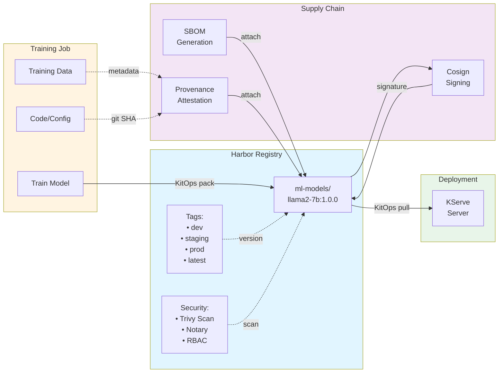
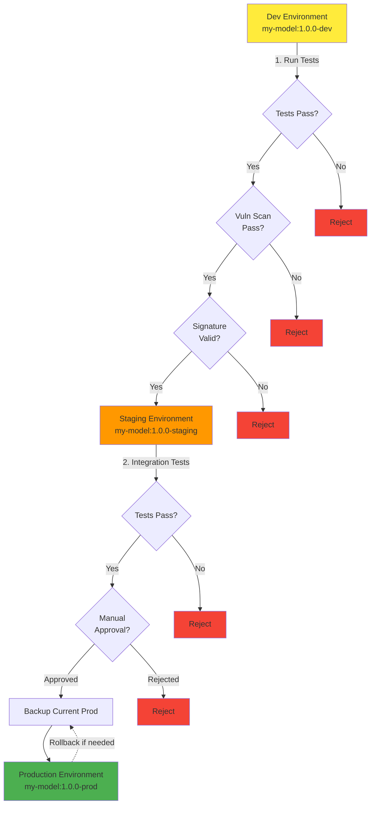
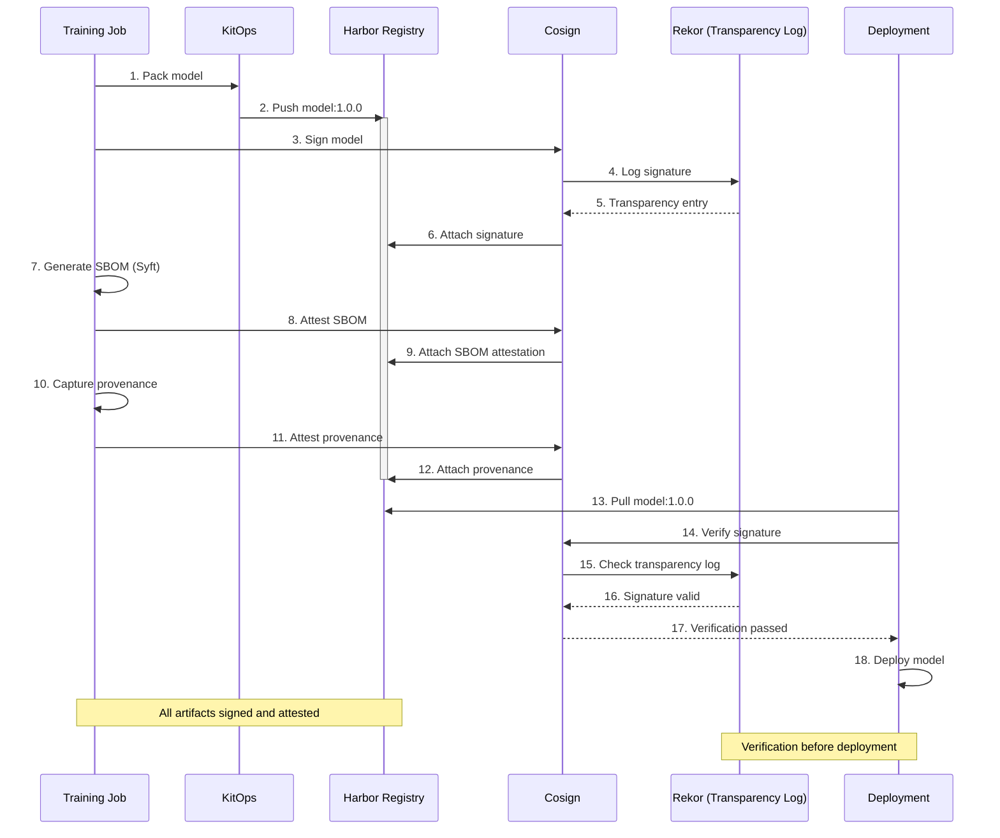

# Model Registry & Packaging Tutorial

This tutorial demonstrates how to set up a complete model registry using Harbor and KitOps, with supply chain security via in-toto and Sigstore/Cosign.

## Overview

The model registry provides:

- **Harbor**: OCI-compliant registry for storing model containers and artifacts
- **KitOps**: Git-like workflows for ML models (pack, push, pull, tag)
- **Versioning**: Semantic versioning (MAJOR.MINOR.PATCH) for models
- **Security**: Cryptographic signing with Cosign, SBOM generation
- **Provenance**: Complete training lineage (data, code, hyperparameters)
- **Promotion**: Dev → Staging → Production workflows with approval gates

## Architecture

### Model Registry Flow



### Model Promotion Workflow



### Signing and Verification Flow



## Prerequisites

1. Kubernetes cluster (1.28+)
2. kubectl configured
3. Helm 3.x installed
4. Docker or compatible container runtime
5. 500Gi storage for model artifacts

## Part 1: Install Harbor Registry

### Step 1.1: Add Harbor Helm repository

```bash
helm repo add harbor https://helm.goharbor.io
helm repo update
```

### Step 1.2: Install Harbor

```bash
helm install harbor harbor/harbor \
  --namespace harbor \
  --create-namespace \
  --set expose.type=loadBalancer \
  --set expose.tls.enabled=true \
  --set expose.tls.certSource=auto \
  --set externalURL=https://harbor.ml-platform.example.com \
  --set harborAdminPassword=Harbor12345 \
  --set persistence.enabled=true \
  --set persistence.persistentVolumeClaim.registry.size=500Gi \
  --set trivy.enabled=true \
  --set notary.enabled=true
```

### Step 1.3: Wait for Harbor to be ready

```bash
kubectl wait --for=condition=ready pod \
  -l app=harbor \
  -n harbor \
  --timeout=10m
```

### Step 1.4: Get Harbor URL

```bash
export HARBOR_URL=$(kubectl get svc -n harbor harbor -o jsonpath='{.status.loadBalancer.ingress[0].ip}')
echo "Harbor URL: https://$HARBOR_URL"
```

### Step 1.5: Login to Harbor

```bash
docker login $HARBOR_URL
# Username: admin
# Password: Harbor12345
```

### Step 1.6: Create projects via API

```bash
HARBOR_URL="https://$HARBOR_URL"
HARBOR_USER="admin"
HARBOR_PASSWORD="Harbor12345"

# Create ml-models project
curl -X POST "$HARBOR_URL/api/v2.0/projects" \
  -u "$HARBOR_USER:$HARBOR_PASSWORD" \
  -H "Content-Type: application/json" \
  -d '{
    "project_name": "ml-models",
    "public": false,
    "metadata": {
      "auto_scan": "true",
      "severity": "high"
    }
  }'

# Create training-images project
curl -X POST "$HARBOR_URL/api/v2.0/projects" \
  -u "$HARBOR_USER:$HARBOR_PASSWORD" \
  -H "Content-Type: application/json" \
  -d '{
    "project_name": "training-images",
    "public": false,
    "metadata": {
      "auto_scan": "true"
    }
  }'
```

**Verification:**

```bash
# List projects
curl -u "$HARBOR_USER:$HARBOR_PASSWORD" "$HARBOR_URL/api/v2.0/projects" | jq .

# Expected output:
# [
#   {
#     "project_id": 1,
#     "name": "ml-models",
#     "public": false,
#     ...
#   }
# ]
```

## Part 2: Install and Use KitOps

### Step 2.1: Install KitOps CLI

```bash
curl -LO https://github.com/jozu-ai/kitops/releases/download/v0.2.0/kit-linux-x86_64.tar.gz
tar -xzf kit-linux-x86_64.tar.gz
sudo mv kit /usr/local/bin/
kit version
```

### Step 2.2: Create a simple model

```bash
mkdir -p my-model/model
cd my-model

# Create dummy model weights
echo "model weights" > model/weights.pth

# Create inference script
cat > inference.py << 'EOF'
import torch

def load_model():
    # Load model from weights.pth
    model = torch.nn.Linear(100, 10)
    model.load_state_dict(torch.load('model/weights.pth'))
    return model

if __name__ == '__main__':
    model = load_model()
    print("Model loaded successfully!")
EOF

# Create requirements
cat > requirements.txt << 'EOF'
torch==2.1.0
numpy==1.24.3
EOF
```

### Step 2.3: Create Kitfile

```bash
cat > Kitfile << 'EOF'
manifestVersion: 1.0
package:
  name: my-first-model
  version: 1.0.0
  description: My first ML model packaged with KitOps
  authors:
    - name: ML Team
      email: ml-team@example.com
  license: Apache-2.0

model:
  name: my-first-model
  path: ./model
  framework: pytorch
  version: 2.1.0
  description: Simple linear model

code:
  - path: ./inference.py
    description: Inference script
  - path: ./requirements.txt
    description: Python dependencies

docs:
  - path: ./README.md
    description: Model documentation
EOF
```

### Step 2.4: Pack model into OCI artifact

```bash
kit pack . -t $HARBOR_URL/ml-models/my-first-model:1.0.0
```

**Expected output:**
```
✓ Model packed successfully
  - Name: my-first-model
  - Version: 1.0.0
  - Size: 1.2 MB
  - Tag: harbor.ml-platform.example.com/ml-models/my-first-model:1.0.0
```

### Step 2.5: Push to Harbor

```bash
# Login to Harbor with KitOps
echo "$HARBOR_PASSWORD" | kit login $HARBOR_URL \
  --username "$HARBOR_USER" \
  --password-stdin

# Push model
kit push $HARBOR_URL/ml-models/my-first-model:1.0.0
```

**Verification:**

```bash
# List repositories
curl -u "$HARBOR_USER:$HARBOR_PASSWORD" \
  "$HARBOR_URL/api/v2.0/projects/ml-models/repositories" | jq .

# Pull model to verify
kit pull $HARBOR_URL/ml-models/my-first-model:1.0.0
kit unpack $HARBOR_URL/ml-models/my-first-model:1.0.0 -d ./unpacked-model
ls -la unpacked-model/
```

## Part 3: Model Versioning and Tagging

### Step 3.1: Semantic versioning

```bash
# Tag model with semantic version
MODEL_NAME="my-first-model"
VERSION="1.0.0"
REGISTRY="$HARBOR_URL/ml-models"

# Immutable tags
kit tag $REGISTRY/$MODEL_NAME:$VERSION $REGISTRY/$MODEL_NAME:1.0.0
kit tag $REGISTRY/$MODEL_NAME:$VERSION $REGISTRY/$MODEL_NAME:1.0.0-abc1234  # Git commit

# Mutable tags (environment)
kit tag $REGISTRY/$MODEL_NAME:$VERSION $REGISTRY/$MODEL_NAME:dev
kit tag $REGISTRY/$MODEL_NAME:$VERSION $REGISTRY/$MODEL_NAME:latest

# Push all tags
kit push $REGISTRY/$MODEL_NAME:1.0.0
kit push $REGISTRY/$MODEL_NAME:1.0.0-abc1234
kit push $REGISTRY/$MODEL_NAME:dev
kit push $REGISTRY/$MODEL_NAME:latest
```

### Step 3.2: Query models by version

```bash
# List all tags for a model
curl -u "$HARBOR_USER:$HARBOR_PASSWORD" \
  "$HARBOR_URL/api/v2.0/projects/ml-models/repositories/$MODEL_NAME/artifacts" \
  | jq '.[] | {tags: .tags[].name, push_time: .push_time}'
```

## Part 4: Supply Chain Security with Cosign

### Step 4.1: Install Cosign

```bash
curl -LO https://github.com/sigstore/cosign/releases/download/v2.2.3/cosign-linux-amd64
sudo mv cosign-linux-amd64 /usr/local/bin/cosign
chmod +x /usr/local/bin/cosign
cosign version
```

### Step 4.2: Sign model with keyless signing

```bash
MODEL_IMAGE="$HARBOR_URL/ml-models/$MODEL_NAME:1.0.0"

# Enable keyless signing
export COSIGN_EXPERIMENTAL=1

# Sign model (uses OIDC for authentication)
cosign sign --yes $MODEL_IMAGE
```

**Expected output:**
```
Generating ephemeral keys...
Retrieving signed certificate...

tlog entry created with index: 12345678
Pushing signature to: harbor.ml-platform.example.com/ml-models/my-first-model
```

### Step 4.3: Verify signature

```bash
cosign verify \
  --certificate-identity-regexp=".*" \
  --certificate-oidc-issuer-regexp=".*" \
  $MODEL_IMAGE
```

**Expected output:**
```
✓ Signature verified
  - Signer: ml-team@example.com
  - Timestamp: 2024-01-15T10:30:00Z
  - Rekor log entry: https://rekor.sigstore.dev/api/v1/log/entries?logIndex=12345678
```

## Part 5: Generate and Attach SBOM

### Step 5.1: Install Syft

```bash
# ⚠️ SECURITY NOTE: For production deployments, download and verify the script first:
#   curl -sSfL https://raw.githubusercontent.com/anchore/syft/main/install.sh -o /tmp/install-syft.sh
#   less /tmp/install-syft.sh  # Review script contents
#   sha256sum /tmp/install-syft.sh  # Verify checksum (obtain from Anchore documentation)
#   sh /tmp/install-syft.sh -b /usr/local/bin
# For this tutorial, we use the official Syft quick-install:
curl -sSfL https://raw.githubusercontent.com/anchore/syft/main/install.sh | sh -s -- -b /usr/local/bin
syft version
```

### Step 5.2: Generate SBOM

```bash
MODEL_IMAGE="$HARBOR_URL/ml-models/$MODEL_NAME:1.0.0"

# Generate SBOM in SPDX format
syft $MODEL_IMAGE -o spdx-json > sbom.spdx.json

# Preview SBOM
syft $MODEL_IMAGE -o table
```

**Expected output:**
```
NAME           VERSION      TYPE
torch          2.1.0        python
numpy          1.24.3       python
```

### Step 5.3: Attach SBOM as attestation

```bash
export COSIGN_EXPERIMENTAL=1

cosign attest \
  --yes \
  --predicate sbom.spdx.json \
  --type spdx \
  $MODEL_IMAGE
```

### Step 5.4: Verify SBOM attestation

```bash
cosign verify-attestation \
  --certificate-identity-regexp=".*" \
  --certificate-oidc-issuer-regexp=".*" \
  --type spdx \
  $MODEL_IMAGE | jq .
```

## Part 6: Scan for Vulnerabilities

### Step 6.1: Install Grype

```bash
# ⚠️ SECURITY NOTE: For production deployments, download and verify the script first:
#   curl -sSfL https://raw.githubusercontent.com/anchore/grype/main/install.sh -o /tmp/install-grype.sh
#   less /tmp/install-grype.sh  # Review script contents
#   sha256sum /tmp/install-grype.sh  # Verify checksum (obtain from Anchore documentation)
#   sh /tmp/install-grype.sh -b /usr/local/bin
# For this tutorial, we use the official Grype quick-install:
curl -sSfL https://raw.githubusercontent.com/anchore/grype/main/install.sh | sh -s -- -b /usr/local/bin
grype version
```

### Step 6.2: Scan model for vulnerabilities

```bash
grype $MODEL_IMAGE
```

**Expected output:**
```
NAME     INSTALLED  VULNERABILITY  SEVERITY
torch    2.1.0      CVE-2024-XXXX  Medium
```

### Step 6.3: Fail on critical vulnerabilities

```bash
grype $MODEL_IMAGE --fail-on critical

# Exit code 1 if critical vulnerabilities found
# Exit code 0 if no critical vulnerabilities
```

## Part 7: Model Promotion Workflow

### Step 7.1: Promote from dev to staging

```bash
MODEL_NAME="my-first-model"
VERSION="1.0.0"
REGISTRY="$HARBOR_URL/ml-models"

DEV_IMAGE="$REGISTRY/$MODEL_NAME:$VERSION-dev"
STAGING_IMAGE="$REGISTRY/$MODEL_NAME:$VERSION-staging"

# Pull dev image
docker pull $DEV_IMAGE

# Run automated tests
docker run --rm $DEV_IMAGE python -m pytest /tests/

# Scan for vulnerabilities
grype $DEV_IMAGE --fail-on critical

# Verify signature
cosign verify \
  --certificate-identity-regexp=".*" \
  --certificate-oidc-issuer-regexp=".*" \
  $DEV_IMAGE

# Tag as staging
docker tag $DEV_IMAGE $STAGING_IMAGE
docker push $STAGING_IMAGE

# Update staging tag
docker tag $DEV_IMAGE $REGISTRY/$MODEL_NAME:staging
docker push $REGISTRY/$MODEL_NAME:staging

echo "✓ Promoted to staging"
```

### Step 7.2: Promote from staging to production

```bash
STAGING_IMAGE="$REGISTRY/$MODEL_NAME:$VERSION-staging"
PROD_IMAGE="$REGISTRY/$MODEL_NAME:$VERSION-prod"

# Run integration tests in staging
kubectl run test-runner --rm -i --restart=Never \
  --image=curlimages/curl:latest -n ml-staging \
  -- sh -c "curl -f http://model-server:8080/health"

# Manual approval
echo "Approve promotion to production? (yes/no)"
read APPROVAL
if [ "$APPROVAL" != "yes" ]; then
  echo "Promotion cancelled"
  exit 1
fi

# Backup current production
CURRENT_PROD=$(kubectl get deployment model-server -n ml-production \
  -o jsonpath='{.spec.template.spec.containers[0].image}')
docker tag $CURRENT_PROD $REGISTRY/$MODEL_NAME:prod-backup-$(date +%Y%m%d)

# Tag as production
docker tag $STAGING_IMAGE $PROD_IMAGE
docker push $PROD_IMAGE

docker tag $STAGING_IMAGE $REGISTRY/$MODEL_NAME:prod
docker push $REGISTRY/$MODEL_NAME:prod

docker tag $STAGING_IMAGE $REGISTRY/$MODEL_NAME:latest
docker push $REGISTRY/$MODEL_NAME:latest

echo "✓ Promoted to production"
```

### Step 7.3: Rollback production

```bash
# Find backup
BACKUP_IMAGE=$(docker images --format "{{.Repository}}:{{.Tag}}" \
  | grep "$REGISTRY/$MODEL_NAME:prod-backup" \
  | head -n 1)

# Tag backup as prod
docker tag $BACKUP_IMAGE $REGISTRY/$MODEL_NAME:prod
docker push $REGISTRY/$MODEL_NAME:prod

# Update deployment
kubectl set image deployment/model-server -n ml-production \
  model-server=$REGISTRY/$MODEL_NAME:prod

echo "✓ Rolled back to $BACKUP_IMAGE"
```

## Part 8: Provenance Tracking

### Step 8.1: Capture provenance during training

```python
import torch
import json
import hashlib
from datetime import datetime

# Training configuration
LEARNING_RATE = 0.001
BATCH_SIZE = 32
EPOCHS = 10

# Capture provenance
provenance = {
    "model": {
        "name": "my-first-model",
        "version": "1.0.0",
        "framework": "pytorch",
        "task": "classification"
    },
    "training": {
        "start_time": datetime.utcnow().isoformat() + "Z",
        "hyperparameters": {
            "learning_rate": LEARNING_RATE,
            "batch_size": BATCH_SIZE,
            "epochs": EPOCHS
        },
        "trainer": "alice@example.com"
    },
    "data": {
        "training_dataset": {
            "name": "imagenet",
            "version": "1.0",
            "sha256": "abc123..."
        }
    },
    "code": {
        "repository": "https://github.com/my-org/ml-models",
        "commit": "abc1234567"
    }
}

# Train model
model = torch.nn.Linear(100, 10)
# ... training code ...

# Save model
torch.save(model.state_dict(), "model/weights.pth")

# Compute model hash
with open("model/weights.pth", "rb") as f:
    model_sha256 = hashlib.sha256(f.read()).hexdigest()

provenance["model"]["sha256"] = model_sha256
provenance["training"]["end_time"] = datetime.utcnow().isoformat() + "Z"

# Save provenance
with open("provenance.json", "w") as f:
    json.dump(provenance, f, indent=2)

print("✓ Provenance saved")
```

### Step 8.2: Attach provenance as attestation

```bash
MODEL_IMAGE="$HARBOR_URL/ml-models/$MODEL_NAME:1.0.0"

# Attach provenance
cosign attest \
  --yes \
  --predicate provenance.json \
  --type slsaprovenance \
  $MODEL_IMAGE
```

### Step 8.3: Query provenance

```bash
# Verify and extract provenance
cosign verify-attestation \
  --certificate-identity-regexp=".*" \
  --certificate-oidc-issuer-regexp=".*" \
  --type slsaprovenance \
  $MODEL_IMAGE | jq '.payload | @base64d | fromjson | .predicate'
```

## Troubleshooting

### Harbor not accessible

```bash
# Check Harbor pods
kubectl get pods -n harbor

# Check service
kubectl get svc -n harbor harbor

# View logs
kubectl logs -n harbor -l app=harbor-core
```

### KitOps push fails

```bash
# Re-login to Harbor
echo "$HARBOR_PASSWORD" | kit login $HARBOR_URL \
  --username "$HARBOR_USER" \
  --password-stdin

# Check network connectivity
curl -k https://$HARBOR_URL/api/v2.0/systeminfo
```

### Cosign signature verification fails

```bash
# Check Rekor transparency log
rekor-cli get --log-index <index>

# Verify with public key instead
cosign verify --key /path/to/cosign.pub $MODEL_IMAGE
```

## Best Practices

1. **Versioning**:
   - Use semantic versioning (MAJOR.MINOR.PATCH)
   - Tag with git commit SHA for traceability
   - Never overwrite immutable tags (1.0.0)

2. **Security**:
   - Sign all production models with Cosign
   - Attach SBOM to every model
   - Scan for vulnerabilities before deployment
   - Use in-toto for supply chain verification

3. **Promotion**:
   - Always promote through dev → staging → production
   - Run automated tests before promotion
   - Require manual approval for production
   - Keep backup of previous production version

4. **Provenance**:
   - Capture complete training metadata
   - Attach provenance as SLSA attestation
   - Include dataset version and git commit
   - Enable reproducibility

5. **Monitoring**:
   - Track promotion success rate
   - Alert on signature verification failures
   - Monitor Harbor storage usage
   - Dashboard for model registry metrics

## Common Pitfalls

### 1. Overwriting Immutable Tags

**Mistake:**
```bash
# Pushing same version tag twice
kit push $HARBOR_URL/ml-models/my-model:1.0.0  # First push
# ... make changes ...
kit push $HARBOR_URL/ml-models/my-model:1.0.0  # ❌ Overwrites!
```

**Impact:** Breaks reproducibility, deployment confusion, audit trail lost.

**Solution:**
```bash
# Use immutable tags with git commit SHA
VERSION="1.0.0"
GIT_SHA=$(git rev-parse --short HEAD)

# Immutable tag (never overwrite)
kit push $HARBOR_URL/ml-models/my-model:${VERSION}-${GIT_SHA}

# Mutable environment tags (can update)
kit tag $HARBOR_URL/ml-models/my-model:${VERSION}-${GIT_SHA} \
  $HARBOR_URL/ml-models/my-model:dev
```

**Harbor Protection:**
```bash
# Enable immutability in Harbor UI
# Project → Configuration → Deployment security → Enable content trust
```

### 2. Not Signing Models

**Mistake:** Deploying unsigned models to production.

**Impact:** No guarantee model wasn't tampered with, supply chain attacks.

**Solution:**
```bash
# ALWAYS sign before deployment
export COSIGN_EXPERIMENTAL=1
cosign sign --yes $MODEL_IMAGE

# Enforce signature verification in admission controller
kubectl apply -f - <<EOF
apiVersion: admissionregistration.k8s.io/v1
kind: ValidatingWebhookConfiguration
metadata:
  name: cosign-verification
spec:
  webhooks:
    - name: verify-signature
      rules:
        - operations: ["CREATE", "UPDATE"]
          apiGroups: [""]
          apiVersions: ["v1"]
          resources: ["pods"]
      # Webhook to verify Cosign signatures
EOF
```

### 3. Missing Provenance

**Mistake:** Not capturing training metadata.

**Impact:** Can't reproduce models, audit failures, debugging impossible.

**Solution:**
```python
# ALWAYS capture provenance during training
provenance = {
    "model": {...},
    "training": {
        "dataset": {
            "name": "imagenet",
            "version": "1.0",
            "sha256": hashlib.sha256(open("data.tar", "rb").read()).hexdigest()
        },
        "code": {
            "repo": os.getenv("GIT_REPO"),
            "commit": os.getenv("GIT_COMMIT"),
            "branch": os.getenv("GIT_BRANCH")
        },
        "hyperparameters": {...},
        "trainer": os.getenv("USER_EMAIL"),
        "timestamp": datetime.utcnow().isoformat()
    }
}

# Attach to model
cosign attest --yes --predicate provenance.json \
  --type slsaprovenance $MODEL_IMAGE
```

### 4. Skipping Vulnerability Scans

**Mistake:** Promoting models with critical CVEs to production.

**Impact:** Security breaches, compliance violations.

**Solution:**
```bash
# ALWAYS scan before promotion
grype $MODEL_IMAGE --fail-on critical

# Automate in CI/CD
# .github/workflows/model-promotion.yml
- name: Scan for vulnerabilities
  run: |
    grype $MODEL_IMAGE --fail-on critical || {
      echo "❌ Critical vulnerabilities found!"
      exit 1
    }
```

**Harbor Auto-Scan:**
```bash
# Enable in Harbor
curl -X PUT "$HARBOR_URL/api/v2.0/projects/ml-models" \
  -u "$HARBOR_USER:$HARBOR_PASSWORD" \
  -H "Content-Type: application/json" \
  -d '{
    "metadata": {
      "auto_scan": "true",
      "severity": "critical",
      "prevent_vul": "true"
    }
  }'
```

### 5. Forgetting to Tag Environments

**Mistake:**
```bash
# Only pushing versioned tag
kit push $HARBOR_URL/ml-models/my-model:1.0.0
# ❌ No dev/staging/prod tags!
```

**Impact:** Deployments hardcode versions, difficult to track what's where.

**Solution:**
```bash
# Always maintain environment tags
VERSION="1.0.0"
REGISTRY="$HARBOR_URL/ml-models/my-model"

# Push version
kit push $REGISTRY:$VERSION

# Tag environment
kit tag $REGISTRY:$VERSION $REGISTRY:dev
kit push $REGISTRY:dev

# Deployments reference environment tags
# spec:
#   containers:
#     - image: harbor.example.com/ml-models/my-model:prod  # ✓ Environment tag
```

### 6. Large Models Without Chunking

**Mistake:** Pushing 50GB model as single blob.

**Impact:** Push/pull timeouts, network issues, slow deployments.

**Solution:**
```bash
# Option 1: Split model into chunks
split -b 1G model.bin model.bin.part.

# Pack with references
cat > Kitfile <<EOF
model:
  name: large-llm
  parts:
    - model.bin.part.aa
    - model.bin.part.ab
    - model.bin.part.ac
EOF

# Option 2: Use external storage + reference
cat > Kitfile <<EOF
model:
  name: large-llm
  storage:
    type: s3
    bucket: ml-models-large
    key: llama-70b/model.bin
EOF
```

### 7. No Model Retention Policy

**Mistake:** Keeping all 500 model versions forever.

**Impact:** Harbor runs out of storage, costs skyrocket.

**Solution:**
```bash
# Set retention policy in Harbor
curl -X POST "$HARBOR_URL/api/v2.0/projects/ml-models/metadatas/retention" \
  -u "$HARBOR_USER:$HARBOR_PASSWORD" \
  -H "Content-Type: application/json" \
  -d '{
    "rules": [
      {
        "disabled": false,
        "priority": 0,
        "action": "retain",
        "template": "always",
        "tag_selectors": [
          {
            "kind": "doublestar",
            "decoration": "matches",
            "pattern": "prod-**"
          }
        ]
      },
      {
        "disabled": false,
        "priority": 1,
        "action": "retain",
        "scope_selectors": {
          "repository": [
            {
              "kind": "doublestar",
              "decoration": "matches",
              "pattern": "**"
            }
          ]
        },
        "tag_selectors": [
          {
            "kind": "doublestar",
            "decoration": "matches",
            "pattern": "**"
          }
        ],
        "params": {
          "latestPushedK": 10
        },
        "template": "latestPushedK"
      }
    ]
  }'

# Keep: All prod-* tags, latest 10 of everything else
```

### 8. Hardcoded Harbor URL

**Mistake:**
```python
# Hardcoded registry URL
MODEL_IMAGE = "harbor.ml-platform.example.com/ml-models/my-model:1.0.0"
```

**Impact:** Can't switch registries, dev/prod use same registry.

**Solution:**
```python
# Use environment variables
REGISTRY_URL = os.getenv("MODEL_REGISTRY_URL", "harbor.ml-platform.example.com")
PROJECT = os.getenv("MODEL_PROJECT", "ml-models")
MODEL_NAME = "my-model"
VERSION = "1.0.0"

MODEL_IMAGE = f"{REGISTRY_URL}/{PROJECT}/{MODEL_NAME}:{VERSION}"

# Configure per environment
# dev: REGISTRY_URL=harbor-dev.example.com
# prod: REGISTRY_URL=harbor-prod.example.com
```

### 9. Promoting Without Testing

**Mistake:**
```bash
# Direct dev → prod promotion
docker tag my-model:dev my-model:prod
docker push my-model:prod  # ❌ No testing!
```

**Impact:** Broken models in production, customer impact.

**Solution:**
```bash
# ALWAYS: dev → staging → prod with gates
promote_to_staging() {
  local DEV_IMAGE=$1
  local STAGING_IMAGE=$2

  # 1. Pull dev image
  docker pull $DEV_IMAGE

  # 2. Run unit tests
  docker run --rm $DEV_IMAGE python -m pytest tests/ || return 1

  # 3. Scan for vulnerabilities
  grype $DEV_IMAGE --fail-on critical || return 1

  # 4. Verify signature
  cosign verify --certificate-identity-regexp=".*" \
    --certificate-oidc-issuer-regexp=".*" $DEV_IMAGE || return 1

  # 5. Tag and push to staging
  docker tag $DEV_IMAGE $STAGING_IMAGE
  docker push $STAGING_IMAGE

  echo "✓ Promoted to staging"
}

promote_to_prod() {
  local STAGING_IMAGE=$1
  local PROD_IMAGE=$2

  # 1. Run integration tests in staging
  kubectl run test-runner --rm -i --restart=Never \
    --image=curlimages/curl:latest -n ml-staging \
    -- sh -c "curl -f http://model-server:8080/v1/models/my-model/infer" || return 1

  # 2. Manual approval
  echo "Approve production deployment? (yes/no)"
  read APPROVAL
  [ "$APPROVAL" != "yes" ] && return 1

  # 3. Backup current prod
  CURRENT_PROD=$(kubectl get deployment model-server -n ml-production \
    -o jsonpath='{.spec.template.spec.containers[0].image}')
  docker tag $CURRENT_PROD ${PROD_IMAGE}-backup-$(date +%Y%m%d)

  # 4. Promote to prod
  docker tag $STAGING_IMAGE $PROD_IMAGE
  docker push $PROD_IMAGE

  echo "✓ Promoted to production"
}
```

### 10. No SBOM Attached

**Mistake:** Deploying models without SBOMs.

**Impact:** Can't identify vulnerable dependencies, compliance failures.

**Solution:**
```bash
# ALWAYS generate and attach SBOM
MODEL_IMAGE="$HARBOR_URL/ml-models/my-model:1.0.0"

# Generate SBOM
syft $MODEL_IMAGE -o spdx-json > sbom.spdx.json

# Attach as attestation
export COSIGN_EXPERIMENTAL=1
cosign attest --yes --predicate sbom.spdx.json \
  --type spdx $MODEL_IMAGE

# Verify SBOM exists
cosign verify-attestation \
  --certificate-identity-regexp=".*" \
  --certificate-oidc-issuer-regexp=".*" \
  --type spdx $MODEL_IMAGE
```

---

## Next Steps

- [Model Serving with KServe](04-model-serving.md)
- [Observability and Monitoring](05-observability.md)
- [Cost Attribution with OpenCost](06-cost-attribution.md)

## References

- [Harbor Documentation](https://goharbor.io/docs/)
- [KitOps GitHub](https://github.com/jozu-ai/kitops)
- [Sigstore/Cosign](https://docs.sigstore.dev/)
- [in-toto](https://in-toto.io/)
- [SLSA Framework](https://slsa.dev/)
