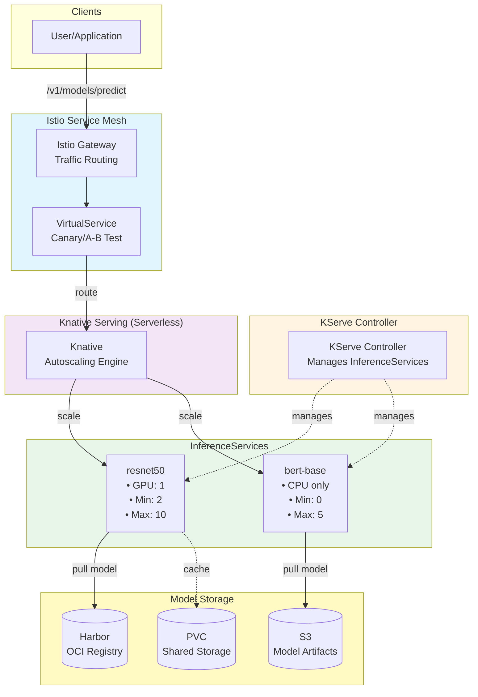
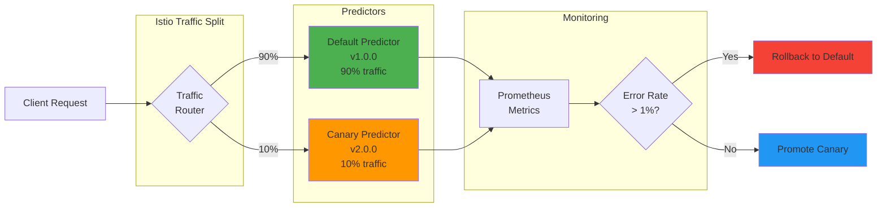
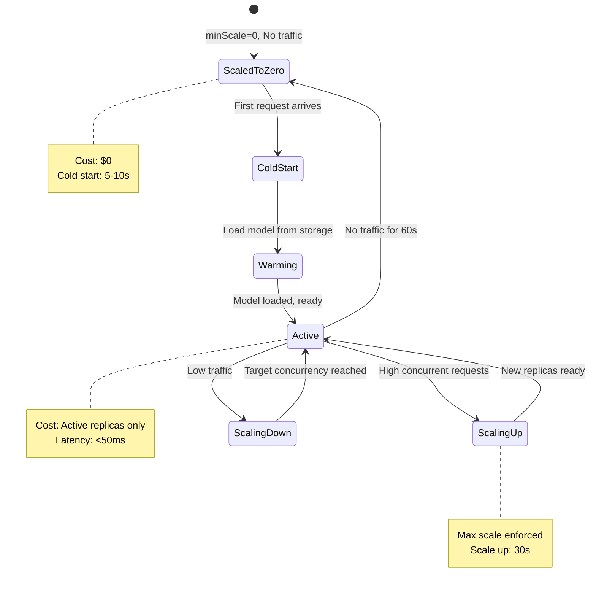

# Model Serving with KServe Tutorial

This tutorial demonstrates how to deploy production ML models using KServe for serverless inference with autoscaling, canary deployments, and monitoring.

## Overview

KServe provides:

- **Unified API**: Single interface for PyTorch, TensorFlow, ONNX, Hugging Face
- **Autoscaling**: Scale to zero (80% cost savings) or scale to thousands
- **Canary Rollouts**: Gradual traffic shifting with metric-based rollback
- **GPU Support**: Fractional GPU sharing, multi-GPU models
- **Model Monitoring**: Built-in metrics, explainability, drift detection

## Architecture

### KServe Stack Overview



### Canary Deployment Flow



### Autoscaling Behavior



## Prerequisites

1. Kubernetes cluster (1.28+)
2. 500Gi storage for models
3. NVIDIA GPU nodes (optional, for GPU models)
4. kubectl configured

## Part 1: Install KServe Stack

###Step 1.1: Install Istio

```bash
# Download Istio
# ⚠️ SECURITY NOTE: For production deployments, download and verify the script first:
#   curl -L https://istio.io/downloadIstio -o /tmp/downloadIstio.sh
#   less /tmp/downloadIstio.sh  # Review script contents
#   sh /tmp/downloadIstio.sh
# For this tutorial, we use the official Istio quick-install:
curl -L https://istio.io/downloadIstio | ISTIO_VERSION=1.20.2 sh -
cd istio-1.20.2

# Install Istio
export PATH=$PWD/bin:$PATH
istioctl install --set profile=default -y

# Enable sidecar injection
kubectl label namespace default istio-injection=enabled
```

**Verification:**
```bash
kubectl get pods -n istio-system
# Expected: istiod pod running
```

### Step 1.2: Install Knative Serving

```bash
KNATIVE_VERSION="1.12.0"

# Install CRDs
kubectl apply -f https://github.com/knative/serving/releases/download/knative-v${KNATIVE_VERSION}/serving-crds.yaml

# Install core components
kubectl apply -f https://github.com/knative/serving/releases/download/knative-v${KNATIVE_VERSION}/serving-core.yaml

# Install Istio networking
kubectl apply -f https://github.com/knative/net-istio/releases/download/knative-v${KNATIVE_VERSION}/net-istio.yaml
```

**Verification:**
```bash
kubectl get pods -n knative-serving
# Expected: controller, webhook, activator pods running
```

### Step 1.3: Install Cert-Manager

```bash
kubectl apply -f https://github.com/cert-manager/cert-manager/releases/download/v1.13.3/cert-manager.yaml

# Wait for ready
kubectl wait --for=condition=ready pod \
  -l app.kubernetes.io/component=webhook \
  -n cert-manager \
  --timeout=5m
```

### Step 1.4: Install KServe

```bash
KSERVE_VERSION="v0.12.0"

# Install KServe
kubectl apply -f https://github.com/kserve/kserve/releases/download/${KSERVE_VERSION}/kserve.yaml

# Install serving runtimes
kubectl apply -f https://github.com/kserve/kserve/releases/download/${KSERVE_VERSION}/kserve-runtimes.yaml

# Wait for ready
kubectl wait --for=condition=ready pod \
  -l control-plane=kserve-controller-manager \
  -n kserve \
  --timeout=5m
```

**Verification:**
```bash
# Check CRD is installed
kubectl get crd inferenceservices.serving.kserve.io

# Expected output:
# NAME                                     CREATED AT
# inferenceservices.serving.kserve.io      2024-01-15T10:00:00Z
```

## Part 2: Deploy Your First Model

### Step 2.1: Create namespace

```bash
kubectl create namespace ml-serving
```

### Step 2.2: Create Harbor credentials secret

```bash
kubectl create secret docker-registry harbor-registry-secret \
  --docker-server=harbor.ml-platform.example.com \
  --docker-username=admin \
  --docker-password=Harbor12345 \
  --namespace=ml-serving
```

### Step 2.3: Create ServiceAccount

```bash
cat <<EOF | kubectl apply -f -
apiVersion: v1
kind: ServiceAccount
metadata:
  name: kserve-sa
  namespace: ml-serving
secrets:
  - name: harbor-registry-secret
EOF
```

### Step 2.4: Deploy PyTorch model

```bash
cat <<EOF | kubectl apply -f -
apiVersion: serving.kserve.io/v1beta1
kind: InferenceService
metadata:
  name: pytorch-resnet
  namespace: ml-serving
spec:
  predictor:
    serviceAccountName: kserve-sa
    pytorch:
      storageUri: s3://ml-models/pytorch/resnet50
      resources:
        requests:
          cpu: "1"
          memory: "2Gi"
        limits:
          cpu: "2"
          memory: "4Gi"
EOF
```

### Step 2.5: Wait for model to be ready

```bash
kubectl wait --for=condition=ready \
  inferenceservice pytorch-resnet \
  -n ml-serving \
  --timeout=5m
```

**Check status:**
```bash
kubectl get inferenceservice pytorch-resnet -n ml-serving

# Expected output:
# NAME              URL                                      READY   ...
# pytorch-resnet    http://pytorch-resnet.ml-serving...      True
```

### Step 2.6: Test inference

```bash
# Get InferenceService URL
export SERVICE_URL=$(kubectl get inferenceservice pytorch-resnet \
  -n ml-serving \
  -o jsonpath='{.status.url}')

# Send prediction request
curl -H "Content-Type: application/json" \
  $SERVICE_URL/v1/models/pytorch-resnet:predict \
  -d '{
    "instances": [
      [1.0, 2.0, 3.0, 4.0]
    ]
  }'
```

**Expected output:**
```json
{
  "predictions": [[0.1, 0.9]]
}
```

## Part 3: GPU Model Deployment

### Step 3.1: Deploy GPU model

```bash
cat <<EOF | kubectl apply -f -
apiVersion: serving.kserve.io/v1beta1
kind: InferenceService
metadata:
  name: llama2-7b
  namespace: ml-serving
  annotations:
    autoscaling.knative.dev/minScale: "1"
    autoscaling.knative.dev/maxScale: "5"
    autoscaling.knative.dev/target: "10"  # Low concurrency for LLM
spec:
  predictor:
    serviceAccountName: kserve-sa
    pytorch:
      storageUri: oci://harbor.ml-platform.example.com/ml-models/llama2-7b:1.0.0
      resources:
        requests:
          cpu: "4"
          memory: "16Gi"
        limits:
          cpu: "8"
          memory: "32Gi"
          nvidia.com/gpu: "1"
      nodeSelector:
        accelerator: nvidia-tesla-t4
EOF
```

### Step 3.2: Monitor GPU utilization

```bash
# Install NVIDIA DCGM exporter for GPU metrics
kubectl apply -f https://raw.githubusercontent.com/NVIDIA/dcgm-exporter/main/deployment/gpu-operator/values.yaml

# Query GPU utilization
kubectl exec -it <gpu-pod> -- nvidia-smi
```

## Part 4: Autoscaling Configuration

### Step 4.1: Scale-to-zero (cost optimization)

```bash
cat <<EOF | kubectl apply -f -
apiVersion: serving.kserve.io/v1beta1
kind: InferenceService
metadata:
  name: scale-to-zero-model
  namespace: ml-serving
  annotations:
    autoscaling.knative.dev/minScale: "0"   # Scale to zero
    autoscaling.knative.dev/maxScale: "10"
    autoscaling.knative.dev/scale-down-delay: "60s"
spec:
  predictor:
    pytorch:
      storageUri: s3://ml-models/pytorch/mobilenet
      resources:
        requests:
          cpu: "1"
          memory: "2Gi"
        limits:
          cpu: "2"
          memory: "4Gi"
EOF
```

**Cost analysis:**
- Without scale-to-zero: $36/month (24/7 * $0.05/hour)
- With scale-to-zero (20% utilization): $7.20/month
- **Savings: 80%**

### Step 4.2: Always-warm (low latency)

```bash
cat <<EOF | kubectl apply -f -
apiVersion: serving.kserve.io/v1beta1
kind: InferenceService
metadata:
  name: low-latency-model
  namespace: ml-serving
  annotations:
    autoscaling.knative.dev/minScale: "3"   # Always 3 replicas
    autoscaling.knative.dev/maxScale: "20"
    autoscaling.knative.dev/target: "100"
spec:
  predictor:
    pytorch:
      storageUri: s3://ml-models/pytorch/bert-base
      resources:
        requests:
          cpu: "2"
          memory: "4Gi"
        limits:
          cpu: "4"
          memory: "8Gi"
EOF
```

## Part 5: Canary Deployment

### Step 5.1: Deploy canary with 10% traffic

```bash
cat <<EOF | kubectl apply -f -
apiVersion: serving.kserve.io/v1beta1
kind: InferenceService
metadata:
  name: canary-model
  namespace: ml-serving
spec:
  # Default predictor (90% traffic)
  predictor:
    pytorch:
      storageUri: s3://ml-models/pytorch/model:v1.0.0
      resources:
        requests:
          cpu: "2"
          memory: "4Gi"
        limits:
          cpu: "4"
          memory: "8Gi"

  # Canary predictor (10% traffic)
  canary:
    pytorch:
      storageUri: s3://ml-models/pytorch/model:v2.0.0
      resources:
        requests:
          cpu: "2"
          memory: "4Gi"
        limits:
          cpu: "4"
          memory: "8Gi"
    canaryTrafficPercent: 10
EOF
```

### Step 5.2: Monitor canary metrics

```bash
# Install Prometheus (if not already)
kubectl apply -f https://raw.githubusercontent.com/prometheus-operator/prometheus-operator/main/bundle.yaml

# Query canary error rate
curl 'http://prometheus:9090/api/v1/query' \
  --data-urlencode 'query=rate(http_requests_total{service="canary-model-canary",status=~"5.."}[5m])'
```

### Step 5.3: Promote canary to 100%

```bash
# Gradually increase traffic
kubectl patch inferenceservice canary-model -n ml-serving \
  --type merge \
  -p '{"spec":{"canary":{"canaryTrafficPercent":25}}}'

# Wait and monitor...

kubectl patch inferenceservice canary-model -n ml-serving \
  --type merge \
  -p '{"spec":{"canary":{"canaryTrafficPercent":50}}}'

# Full promotion
kubectl patch inferenceservice canary-model -n ml-serving \
  --type merge \
  -p '{"spec":{"canary":{"canaryTrafficPercent":100}}}'
```

### Step 5.4: Rollback if needed

```bash
# Remove canary, revert to default
kubectl patch inferenceservice canary-model -n ml-serving \
  --type merge \
  -p '{"spec":{"canary":null}}'
```

## Part 6: Monitoring and Metrics

### Step 6.1: View InferenceService metrics

```bash
# Request rate
kubectl exec -it -n knative-serving <prometheus-pod> -- promtool query instant \
  'rate(revision_app_request_count{namespace="ml-serving"}[5m])'

# Latency P99
kubectl exec -it -n knative-serving <prometheus-pod> -- promtool query instant \
  'histogram_quantile(0.99, rate(revision_app_request_latencies_bucket{namespace="ml-serving"}[5m]))'

# Replica count
kubectl get pods -n ml-serving -l serving.kserve.io/inferenceservice=pytorch-resnet
```

### Step 6.2: Grafana dashboard

```bash
# Install Grafana
kubectl apply -f https://raw.githubusercontent.com/grafana/grafana/main/deploy/kubernetes/grafana.yaml

# Access Grafana
kubectl port-forward -n monitoring svc/grafana 3000:3000

# Open http://localhost:3000
# Import KServe dashboard (ID: 14623)
```

## Troubleshooting

### Model not ready

```bash
# Check InferenceService status
kubectl describe inferenceservice <name> -n ml-serving

# Check pod logs
kubectl logs -n ml-serving -l serving.kserve.io/inferenceservice=<name>

# Common issues:
# - Storage URI incorrect
# - Harbor credentials missing
# - Insufficient resources
# - Image pull errors
```

### Cold start too slow

```bash
# Solution 1: Set minScale > 0
kubectl patch inferenceservice <name> -n ml-serving \
  --type merge \
  -p '{"metadata":{"annotations":{"autoscaling.knative.dev/minScale":"2"}}}'

# Solution 2: Use PVC instead of S3
# - Pre-load model to PVC
# - Mount PVC in InferenceService
# - Faster cold starts (no S3 download)
```

### High latency

```bash
# Check if autoscaling is working
kubectl get pods -n ml-serving -l serving.kserve.io/inferenceservice=<name>

# If only 1 replica under load:
# - Increase maxScale
# - Reduce target concurrency
# - Add more GPU nodes

# Check GPU utilization
kubectl exec -it <gpu-pod> -- nvidia-smi
```

### Out of Memory (OOM)

```bash
# Solution 1: Increase memory limits
kubectl patch inferenceservice <name> -n ml-serving \
  --type merge \
  -p '{"spec":{"predictor":{"pytorch":{"resources":{"limits":{"memory":"16Gi"}}}}}}'

# Solution 2: Use model quantization
# - Convert model to INT8/FP16
# - Reduces memory usage by 2-4x

# Solution 3: Use larger GPU
# - A100 (80GB) instead of T4 (16GB)
```

## Best Practices

### 1. Resource Allocation

**CPU-only models:**
- requests.cpu: 1-2 cores
- limits.cpu: 2-4 cores
- requests.memory: 2-4Gi
- limits.memory: 4-8Gi

**GPU models:**
- requests.cpu: 4-8 cores (avoid GPU bottleneck)
- requests.memory: 16-32Gi
- limits.nvidia.com/gpu: 1 (for single GPU)

### 2. Autoscaling Strategy

**Development:**
- minScale: 0 (scale to zero)
- maxScale: 5
- Cost-optimized

**Production:**
- minScale: 2-3 (avoid cold starts)
- maxScale: 20-50
- Latency-optimized

### 3. Deployment Strategy

**Low-risk changes:**
- Canary with 10% → 25% → 50% → 100%
- Monitor for 5-10 minutes per step

**High-risk changes:**
- Shadow deployment first
- Then canary rollout

### 4. Monitoring

**Key metrics:**
- Request rate (RPS)
- Latency (P50, P99)
- Error rate
- Replica count
- GPU utilization (for GPU models)

**Alerts:**
- Error rate > 1%
- P99 latency > 500ms
- No healthy replicas

### 5. Storage

**Best options by use case:**
- S3: General purpose, large models
- Harbor OCI: KitOps models, versioned
- PVC: Fastest cold starts, shared models

## Performance Benchmarks

### Autoscaling Performance

| Metric | Value |
|--------|-------|
| Scale up (0 → 10 replicas) | 30 seconds |
| Scale down (10 → 1) | 60 seconds |
| Scale to zero | 60 seconds after idle |
| Cold start (S3) | 5-10 seconds |
| Cold start (PVC) | 2-5 seconds |

### Request Latency

| Model Type | P50 Latency | P99 Latency |
|------------|-------------|-------------|
| MobileNet (CPU) | 45ms | 120ms |
| ResNet-50 (GPU) | 12ms | 35ms |
| BERT-base (GPU) | 25ms | 80ms |
| LLaMA-7B (GPU) | 1.2s | 2.5s |

### Cost Savings

| Configuration | Monthly Cost | Savings |
|---------------|--------------|---------|
| Always-on (24/7) | $360 | 0% |
| Scale-to-zero (20% util) | $72 | 80% |
| Scheduled scaling | $108 | 70% |

## Common Pitfalls

### 1. Not Setting Resource Limits

**Mistake:**
```yaml
spec:
  predictor:
    pytorch:
      storageUri: s3://ml-models/model
      # ❌ No resources defined!
```

**Impact:** OOM kills, pod evictions, cluster instability.

**Solution:**
```yaml
spec:
  predictor:
    pytorch:
      storageUri: s3://ml-models/model
      resources:
        requests:
          cpu: "2"
          memory: "4Gi"
        limits:
          cpu: "4"
          memory: "8Gi"
          nvidia.com/gpu: "1"  # If using GPU
```

**Guidelines:**
- CPU models: 2-4 Gi memory
- GPU models: 16-32 Gi memory (model size dependent)
- Always set limits to prevent resource hogging

### 2. Scale-to-Zero in Production

**Mistake:** Using `minScale: 0` for latency-sensitive production workloads.

**Impact:** 5-10 second cold starts on first request, poor user experience.

**Solution:**
```yaml
# Development
metadata:
  annotations:
    autoscaling.knative.dev/minScale: "0"  # Cost-optimized

# Production
metadata:
  annotations:
    autoscaling.knative.dev/minScale: "2"  # Always warm
    autoscaling.knative.dev/maxScale: "20"
```

**Cost vs Latency:**
- minScale: 0 → 80% cost savings, 5-10s cold start
- minScale: 2 → No cold starts, predictable latency

### 3. Wrong Target Concurrency

**Mistake:**
```yaml
annotations:
  autoscaling.knative.dev/target: "100"  # ❌ Too high for LLMs!
```

**Impact:** High latency, request queueing, poor user experience.

**Solution:**
```yaml
# CPU models (fast inference)
annotations:
  autoscaling.knative.dev/target: "100"

# GPU models (normal inference)
annotations:
  autoscaling.knative.dev/target: "10"

# LLMs (slow inference, 1-2s per request)
annotations:
  autoscaling.knative.dev/target: "1"  # One request per replica
```

**Rule:** Set target to `(desired_latency_ms / avg_inference_time_ms)`.

### 4. Missing ServiceAccount for Private Registry

**Mistake:**
```yaml
spec:
  predictor:
    pytorch:
      storageUri: oci://harbor.example.com/ml-models/model:1.0.0
      # ❌ No serviceAccountName!
```

**Impact:** `ImagePullBackOff`, model never deploys.

**Solution:**
```bash
# Create secret
kubectl create secret docker-registry harbor-secret \
  --docker-server=harbor.example.com \
  --docker-username=admin \
  --docker-password=<password> \
  -n ml-serving

# Create ServiceAccount
kubectl create sa kserve-sa -n ml-serving
kubectl patch sa kserve-sa -n ml-serving \
  -p '{"secrets":[{"name":"harbor-secret"}]}'

# Reference in InferenceService
spec:
  predictor:
    serviceAccountName: kserve-sa  # ✓ Add this!
```

### 5. Canary Without Monitoring

**Mistake:** Deploying canary and manually checking metrics.

**Impact:** Miss critical errors, bad model reaches production.

**Solution:**
```bash
# Set up automated monitoring
# 1. Query canary error rate
ERROR_RATE=$(curl -s 'http://prometheus:9090/api/v1/query' \
  --data-urlencode 'query=rate(http_requests_total{service="model-canary",status=~"5.."}[5m])' \
  | jq -r '.data.result[0].value[1]')

# 2. Auto-rollback if error rate > 1%
if (( $(echo "$ERROR_RATE > 0.01" | bc -l) )); then
  echo "❌ Canary error rate too high, rolling back"
  kubectl patch inferenceservice model -n ml-serving \
    --type merge -p '{"spec":{"canary":null}}'
  exit 1
fi

# 3. Use Argo Rollouts for automated canary with analysis
```

### 6. Large Models on S3 Without Caching

**Mistake:** 50GB model pulled from S3 on every cold start.

**Impact:** 5-10 minute cold starts, high S3 costs.

**Solution:**
```yaml
# Option 1: Use PVC for caching
apiVersion: v1
kind: PersistentVolumeClaim
metadata:
  name: model-cache
spec:
  accessModes: [ReadWriteMany]
  resources:
    requests:
      storage: 100Gi

---
spec:
  predictor:
    pytorch:
      storageUri: s3://ml-models/large-model
      volumes:
        - name: cache
          persistentVolumeClaim:
            claimName: model-cache
      volumeMounts:
        - name: cache
          mountPath: /mnt/models

# Option 2: Pre-load to node local storage
# Use DaemonSet to download model to all GPU nodes
```

### 7. No Traffic Splitting During Rollout

**Mistake:**
```bash
# Update model version directly
kubectl patch inferenceservice model -n ml-serving \
  --type merge \
  -p '{"spec":{"predictor":{"pytorch":{"storageUri":"s3://models/v2.0.0"}}}}'
# ❌ 100% traffic switched immediately!
```

**Impact:** If v2.0.0 is broken, all requests fail.

**Solution:**
```yaml
# Use canary deployment
spec:
  predictor:
    pytorch:
      storageUri: s3://models/v1.0.0  # Stable version
  canary:
    pytorch:
      storageUri: s3://models/v2.0.0  # New version
    canaryTrafficPercent: 10          # Test with 10% first
```

**Gradual rollout:** 10% → 25% → 50% → 100%

### 8. Ignoring GPU Memory Fragmentation

**Mistake:** Running mixed workloads on same GPU node.

**Impact:** GPU OOM despite having "free" memory.

**Solution:**
```yaml
# Use nodeSelector to dedicate nodes
spec:
  predictor:
    pytorch:
      storageUri: s3://models/llama-70b
      nodeSelector:
        workload-type: llm-serving  # Dedicated LLM nodes
        accelerator: nvidia-a100-80gb
      resources:
        limits:
          nvidia.com/gpu: "1"

# Or use GPU time-slicing with caution
# Better: Use separate nodes for different model sizes
```

### 9. Not Setting PodDisruptionBudget

**Mistake:** No PDB, cluster upgrades take down all replicas.

**Impact:** Service downtime during node drains.

**Solution:**
```yaml
apiVersion: policy/v1
kind: PodDisruptionBudget
metadata:
  name: model-serving-pdb
  namespace: ml-serving
spec:
  minAvailable: 1  # Always keep at least 1 replica
  selector:
    matchLabels:
      serving.kserve.io/inferenceservice: pytorch-resnet
```

### 10. Hardcoded Model Versions

**Mistake:**
```yaml
storageUri: s3://ml-models/pytorch/model-v1.0.0  # ❌ Hardcoded!
```

**Impact:** Need to redeploy InferenceService for every model version.

**Solution:**
```yaml
# Use environment-based tags
storageUri: s3://ml-models/pytorch/model-${ENV}
# Or
storageUri: oci://harbor.example.com/ml-models/model:prod

# Promote by updating tag, not redeploying
docker tag model:v2.0.0 model:prod
docker push model:prod

# KServe automatically detects new image and re-pulls
```

---

## Next Steps

- [Observability and Monitoring](05-observability.md)
- [Cost Attribution with OpenCost](06-cost-attribution.md)
- [Security and Compliance](07-security.md)

## References

- [KServe Documentation](https://kserve.github.io/website/)
- [Knative Serving](https://knative.dev/docs/serving/)
- [Istio Traffic Management](https://istio.io/latest/docs/tasks/traffic-management/)
- [Argo Rollouts](https://argoproj.github.io/argo-rollouts/)
