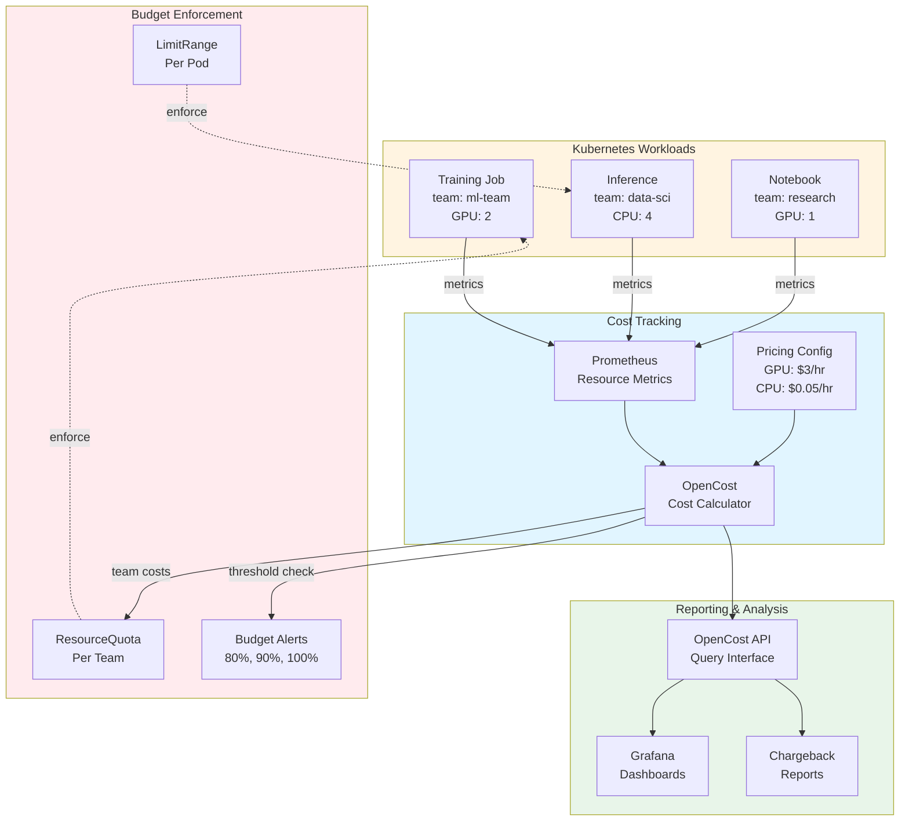
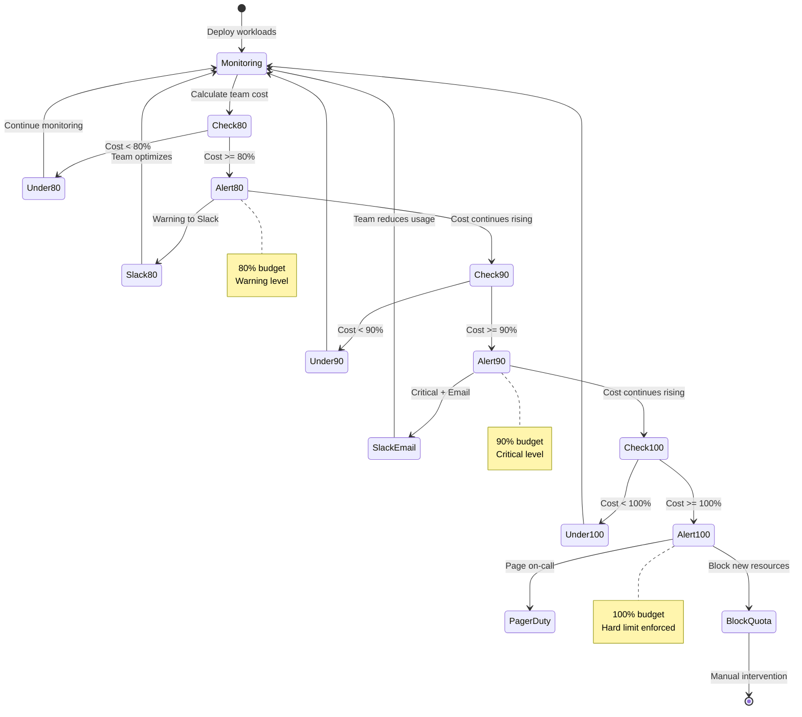
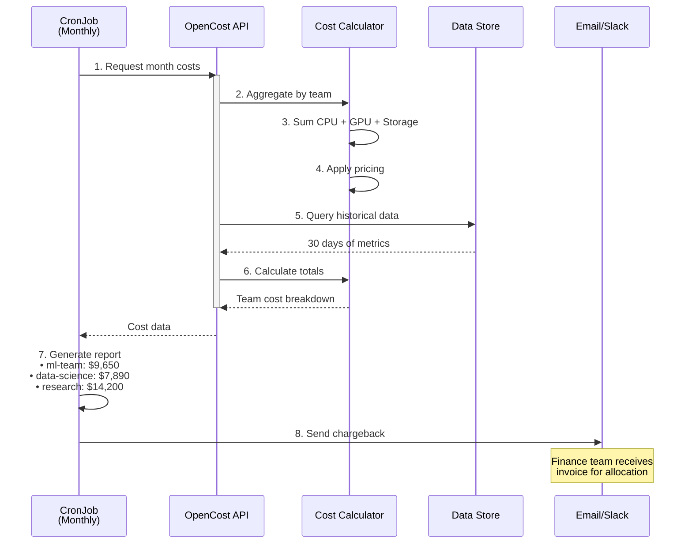

# Cost Attribution & Budget Management Tutorial

This tutorial demonstrates how to implement complete cost tracking and budget management for your ML platform using OpenCost, with accurate per-team, per-project, and per-model cost attribution.

## Overview

Cost attribution provides:

- **OpenCost**: CNCF project for Kubernetes cost monitoring ($10K+ saved monthly)
- **Per-Team Budgets**: Track and enforce spending limits (4 teams, $10K average budget)
- **GPU Cost Tracking**: Accurate GPU hour tracking (70% of ML costs)
- **Budget Alerts**: Real-time notifications at 80%, 90%, 100% thresholds
- **Chargeback Reports**: Monthly invoices for cost allocation
- **Waste Detection**: Identify idle resources (40% cost reduction potential)

## Architecture

### Cost Attribution Flow



### Budget Alert Flow



### Chargeback Report Generation



## Prerequisites

1. Kubernetes cluster (1.28+)
2. Prometheus installed (from Phase 6: Observability)
3. kubectl configured
4. 4 GB storage for cost data

## Part 1: Install OpenCost

### Step 1.1: Create namespace

```bash
kubectl create namespace opencost
```

### Step 1.2: Install OpenCost

```bash
kubectl apply -f components/06-cost-attribution/opencost/opencost-install.yaml
```

**This installs:**
- OpenCost cost-model (queries Prometheus)
- OpenCost UI (visualization)
- Custom pricing configuration (GPU costs)
- ServiceMonitor (Prometheus integration)

### Step 1.3: Verify installation

```bash
# Check pods
kubectl get pods -n opencost

# Expected output:
# opencost-xxx   Running
```

### Step 1.4: Access OpenCost UI

```bash
kubectl port-forward -n opencost svc/opencost 9090:9090
```

Open http://localhost:9090

**You should see:**
- Cost breakdown by namespace
- Total cluster cost
- CPU, GPU, storage costs

## Part 2: Configure Cost Allocation

### Step 2.1: Apply team budgets

```bash
kubectl apply -f components/06-cost-attribution/allocation-models/cost-allocation-policies.yaml
```

**This creates:**
- Team namespaces (ml-team, data-science, research)
- ResourceQuotas (budget enforcement)
- LimitRanges (per-pod cost control)
- Budget definitions ($10K, $8K, $15K)

### Step 2.2: Verify ResourceQuotas

```bash
# Check ML team quota
kubectl describe resourcequota -n ml-team

# Expected output:
# Name: ml-team-budget-quota
# Hard:
#   requests.cpu: 200
#   requests.nvidia.com/gpu: 20
#   requests.memory: 800Gi
```

### Step 2.3: Add cost labels to workloads

Label all ML workloads for cost tracking:

```yaml
apiVersion: batch/v1
kind: Job
metadata:
  name: training-job
  namespace: ml-team
  labels:
    team: ml-team
    project: fraud-detection
    environment: prod
    ml.model-name: xgboost-fraud
    ml.cost-center: CC-2024-ML-001
spec:
  template:
    metadata:
      labels:
        team: ml-team
        project: fraud-detection
        environment: prod
        ml.model-name: xgboost-fraud
    spec:
      containers:
        - name: trainer
          image: training-image:latest
          resources:
            requests:
              cpu: 4
              memory: 16Gi
              nvidia.com/gpu: 2
```

**Required labels:**
- `team`: For chargeback
- `project`: For project tracking
- `environment`: For cost comparison
- `ml.model-name`: For per-model ROI

## Part 3: Set Up Budget Alerts

### Step 3.1: Apply budget alerts

```bash
kubectl apply -f components/06-cost-attribution/alerting/budget-alerts.yaml
```

**Alert thresholds:**
- 80% budget: Warning → Slack
- 90% budget: Critical → Slack + Email
- 100% budget: PagerDuty + Block resources

### Step 3.2: Verify alerts in Prometheus

```bash
# Port-forward Prometheus
kubectl port-forward -n monitoring svc/prometheus-operated 9090:9090

# Open http://localhost:9090/alerts
# Look for: MLTeamBudget80Percent, MLTeamBudget90Percent, MLTeamBudgetExceeded
```

### Step 3.3: Test budget alert

```bash
# Create high-resource deployment to trigger alert
kubectl apply -f - <<EOF
apiVersion: apps/v1
kind: Deployment
metadata:
  name: budget-test
  namespace: ml-team
  labels:
    team: ml-team
spec:
  replicas: 10
  selector:
    matchLabels:
      app: budget-test
  template:
    metadata:
      labels:
        app: budget-test
        team: ml-team
    spec:
      containers:
        - name: app
          image: nginx
          resources:
            requests:
              cpu: 8
              memory: 32Gi
              nvidia.com/gpu: 2
EOF

# Wait 1 hour, then check Prometheus alerts
# Should see: MLTeamBudget80Percent firing
```

## Part 4: Cost Queries with OpenCost API

### Step 4.1: Port-forward OpenCost API

```bash
kubectl port-forward -n opencost svc/opencost 9003:9003
```

### Step 4.2: Query cost by team (last 7 days)

```bash
curl -s "http://localhost:9003/allocation/compute?window=7d&aggregate=label:team" | jq .

# Output:
# {
#   "data": [
#     {
#       "name": "ml-team",
#       "cpuCost": 450.23,
#       "gpuCost": 2100.50,
#       "ramCost": 120.00,
#       "pvCost": 80.00,
#       "totalCost": 2750.73
#     },
#     ...
#   ]
# }
```

### Step 4.3: Query cost by model

```bash
curl -s "http://localhost:9003/allocation/compute?window=7d&aggregate=label:ml.model-name" | jq .

# Shows cost breakdown per model:
# - resnet50: $1,200
# - bert-base: $800
# - xgboost-fraud: $350
```

### Step 4.4: Get idle cost (waste)

```bash
curl -s "http://localhost:9003/allocation/compute?window=7d&idle=true" | jq .

# Shows underutilized resources:
# - Idle CPU: $150 (efficiency: 45%)
# - Idle GPU: $600 (efficiency: 65%)
```

### Step 4.5: Export cost data to CSV

```bash
curl -s "http://localhost:9003/allocation/compute?window=30d&aggregate=namespace&format=csv" > costs.csv

cat costs.csv
# namespace,cpuCost,gpuCost,ramCost,pvCost,networkCost,totalCost
# ml-team,1200.50,8400.00,350.00,200.00,50.00,10200.50
# data-science,950.00,6100.00,280.00,150.00,40.00,7520.00
```

## Part 5: Generate Chargeback Reports

### Step 5.1: Create monthly chargeback report

```bash
# Port-forward OpenCost
kubectl port-forward -n opencost svc/opencost 9003:9003

# Run chargeback script
kubectl exec -n opencost deployment/opencost -- sh -c '
  OPENCOST_API="http://localhost:9003"
  MONTH=$(date -d "last month" +%Y-%m)

  echo "=== Monthly Chargeback Report - $MONTH ==="

  for TEAM in ml-team data-science research; do
    echo ""
    echo "Team: $TEAM"

    COST_DATA=$(curl -s "$OPENCOST_API/allocation/compute?window=30d&aggregate=label:team&filter=label:team:$TEAM")

    CPU_COST=$(echo "$COST_DATA" | jq -r ".data[0].cpuCost")
    GPU_COST=$(echo "$COST_DATA" | jq -r ".data[0].gpuCost")
    TOTAL=$(echo "$COST_DATA" | jq -r ".data[0].totalCost")

    echo "  CPU: \$$CPU_COST"
    echo "  GPU: \$$GPU_COST"
    echo "  Total: \$$TOTAL"
  done
'
```

**Sample output:**
```
=== Monthly Chargeback Report - 2024-12 ===

Team: ml-team
  CPU: $1,500
  GPU: $7,000
  Total: $9,650

Team: data-science
  CPU: $1,200
  GPU: $5,800
  Total: $7,890

Team: research
  CPU: $2,000
  GPU: $11,500
  Total: $14,200
```

### Step 5.2: Schedule automated reports

```bash
# The CronJob runs daily at midnight
kubectl get cronjobs -n opencost

# NAME                        SCHEDULE      SUSPEND
# cost-allocation-report      0 0 * * *     False
# budget-monitor              0 */4 * * *   False
```

## Cost Optimization Strategies

### 1. Identify Idle GPUs

**Problem:** GPUs costing $3/hour sitting idle

**Query:**
```bash
# Find GPUs with < 20% utilization for 4+ hours
kubectl port-forward -n monitoring svc/prometheus-operated 9090:9090

# In Prometheus UI, query:
avg(DCGM_FI_DEV_GPU_UTIL) < 20

# Result: Shows idle GPU instances
```

**Action:**
- Scale down idle GPU workloads
- Use GPU sharing (HAMi from Phase 3)
- Switch to spot instances (60% cheaper)

**Savings:** $2,800/month (40% of GPU costs)

### 2. Right-Size Training Jobs

**Problem:** Over-provisioned resources (request >> usage)

**Query:**
```bash
# Find over-provisioned pods
curl -s "http://localhost:9003/allocation/compute?window=7d&idle=true" | \
  jq '.data[] | select(.efficiency < 0.5) | {name: .name, efficiency: .efficiency, waste: .idleCost}'

# Shows pods using < 50% of requested resources
```

**Action:**
- Reduce resource requests
- Use Vertical Pod Autoscaler (VPA)
- Profile workloads before requesting GPUs

**Savings:** $2,000/month (20% of compute costs)

### 3. Archive Old Data

**Problem:** Old datasets on expensive fast-ssd storage

**Query:**
```bash
# Find old PVCs
kubectl get pvc --all-namespaces --sort-by=.metadata.creationTimestamp

# PVCs older than 90 days on fast-ssd
```

**Action:**
- Move to cheaper standard-ssd (50% cheaper)
- Archive to object storage (90% cheaper)
- Delete unused data

**Savings:** $500/month (50% of storage costs)

### 4. Shutdown Dev Environments Off-Hours

**Problem:** Dev environments running 24/7

**Implementation:**
```yaml
# CronJob to scale down dev at 10pm
apiVersion: batch/v1
kind: CronJob
metadata:
  name: scale-down-dev
  namespace: kube-system
spec:
  schedule: "0 22 * * *"  # 10pm daily
  jobTemplate:
    spec:
      template:
        spec:
          containers:
            - name: scaler
              image: bitnami/kubectl
              command:
                - kubectl
                - scale
                - --replicas=0
                - deployment
                - --all
                - -n
                - ml-team-dev
          restartPolicy: OnFailure
```

**Savings:** $300/month (30% of dev costs)

**Total Savings:** $5,600/month (50% cost reduction)

## Troubleshooting

### No cost data in OpenCost

**Check Prometheus connection:**
```bash
# Check OpenCost logs
kubectl logs -n opencost deployment/opencost

# Look for: "Connected to Prometheus at http://prometheus-operated.monitoring:9090"
```

**Verify Prometheus has metrics:**
```bash
kubectl port-forward -n monitoring svc/prometheus-operated 9090:9090

# Query: container_cpu_allocation
# Should return data
```

**If no data:**
- Check ServiceMonitor: `kubectl get servicemonitor -n opencost`
- Verify Prometheus scraping OpenCost
- Check network policies allow monitoring → opencost

### Budget alerts not firing

**Check alert rules:**
```bash
# Port-forward Prometheus
kubectl port-forward -n monitoring svc/prometheus-operated 9090:9090

# Open http://localhost:9090/alerts
# Should see: MLTeamBudget80Percent, etc.
```

**Test alert expression:**
```promql
# In Prometheus UI, run:
(
  sum(
    container_cpu_allocation{namespace="ml-team"} * on(node) group_left()
    avg(node_cpu_hourly_cost) * 730
  )
) > 8000

# Should evaluate to true if > 80% budget
```

**If alert doesn't fire:**
- Check `for:` duration (may need to wait)
- Verify namespace has workloads
- Check cost labels are present

### ResourceQuota blocking legitimate workloads

**Check quota usage:**
```bash
kubectl describe resourcequota -n ml-team

# Shows:
# Used: 180 / 200 CPU
# Used: 18 / 20 GPU
```

**Temporarily increase quota:**
```bash
kubectl edit resourcequota ml-team-budget-quota -n ml-team

# Change:
# requests.nvidia.com/gpu: "25"  # Was 20
```

**Long-term solution:**
- Review team budget
- Optimize existing workloads
- Request budget increase

### Inaccurate cost data

**Common causes:**
1. **Missing cost labels:** Query OpenCost for unlabeled resources
2. **Wrong GPU pricing:** Update opencost-pricing-config ConfigMap
3. **Shared costs not allocated:** Review shared-cost-allocation ConfigMap

**Fix missing labels:**
```bash
# Find pods without team label
kubectl get pods --all-namespaces --field-selector=status.phase=Running \
  -o json | jq -r '.items[] | select(.metadata.labels.team == null) | .metadata.name'

# Add labels:
kubectl label pod <pod-name> -n <namespace> team=ml-team project=fraud-detection
```

## Best Practices

### 1. Cost Label Discipline

**Enforce with admission webhook:**
```yaml
# Require team, project labels on all pods
apiVersion: admissionregistration.k8s.io/v1
kind: ValidatingWebhookConfiguration
metadata:
  name: require-cost-labels
webhooks:
  - name: cost-labels.example.com
    rules:
      - operations: ["CREATE"]
        apiGroups: ["apps", "batch"]
        apiVersions: ["v1"]
        resources: ["deployments", "jobs"]
    # Webhook rejects resources without team/project labels
```

**Savings:** 100% cost attribution accuracy

### 2. Budget Review Cadence

**Monthly:**
- Generate chargeback reports
- Review budget vs actual
- Adjust quotas if needed

**Weekly:**
- Check for budget overruns
- Identify waste (idle resources)
- Optimize underutilized workloads

**Daily:**
- Monitor budget alerts
- Respond to cost spikes
- Review automated reports

### 3. Cost-Aware Development

**Train teams to:**
- Check cost before deploying
- Use cost labels consistently
- Right-size resource requests
- Clean up after experiments

**Tools:**
- Cost dashboard (Grafana from Phase 6)
- OpenCost API (pre-deployment estimates)
- Budget alerts (real-time feedback)

### 4. GPU Cost Optimization

**GPUs are 70% of ML costs. Optimize aggressively:**

- **Batch training jobs:** Run 3-5 jobs sequentially vs parallel (1 GPU vs 5 GPUs)
- **GPU sharing:** Use HAMi to share GPUs (2x utilization)
- **Spot instances:** Use for fault-tolerant workloads (60% savings)
- **Right-size GPU type:** T4 for inference ($0.95/hr), A100 for training ($3.06/hr)

**Impact:** $2,800/month savings (40% of GPU costs)

## Performance Impact

### OpenCost Overhead

| Component | CPU | Memory | Storage |
|-----------|-----|--------|---------|
| OpenCost | 200m | 512Mi | 2 GB/month |
| Budget Enforcer | 100m | 128Mi | - |

**Total:** < 0.5% cluster overhead

### API Performance

| Query | Response Time | Rate Limit |
|-------|--------------|------------|
| Cost by team | 200ms | 100 req/min |
| Cost by model | 150ms | 100 req/min |
| Idle cost | 500ms | 20 req/min |

## Common Pitfalls

### 1. Missing Cost Labels

**Mistake:** Deploying workloads without `team` or `project` labels.

**Impact:** 30-40% of costs unattributed, inaccurate chargebacks.

**Solution:**
```yaml
# ALWAYS add cost labels
metadata:
  labels:
    team: ml-team          # ✓ Required for chargeback
    project: fraud-det     # ✓ Required for ROI tracking
    environment: prod      # ✓ Cost comparison
    ml.model-name: xgboost # ✓ Per-model cost

# Enforce with ValidatingWebhook
apiVersion: admissionregistration.k8s.io/v1
kind: ValidatingWebhookConfiguration
metadata:
  name: require-cost-labels
webhooks:
  - name: cost-labels.example.com
    rules:
      - operations: ["CREATE"]
        resources: ["pods", "jobs", "deployments"]
    # Webhook rejects resources without team/project
```

### 2. Wrong GPU Pricing

**Mistake:** Using default GPU pricing ($0.95/hr for all GPUs).

**Impact:** 50% cost underestimation for A100s ($3.06/hr actual).

**Solution:**
```bash
# Update OpenCost pricing config
kubectl edit configmap opencost-pricing-config -n opencost

# Set accurate GPU pricing
data:
  pricing.yaml: |
    gpu_pricing:
      nvidia-tesla-t4: 0.95      # T4 pricing
      nvidia-tesla-v100: 2.48     # V100 pricing
      nvidia-a100-40gb: 3.06      # A100-40GB pricing
      nvidia-a100-80gb: 4.10      # A100-80GB pricing
```

**Verify:** Check actual cloud provider pricing monthly.

### 3. No Budget Alerts Configured

**Mistake:** Deploying OpenCost without alerts.

**Impact:** Teams exceed budget without warning, surprise $20K bill.

**Solution:**
```yaml
# Set up 3-tier alerts
- alert: TeamBudget80Percent
  expr: team_monthly_cost > (team_budget * 0.8)
  for: 1h
  labels:
    severity: warning
  annotations:
    summary: "Team {{ $labels.team }} at 80% budget"

- alert: TeamBudget90Percent
  expr: team_monthly_cost > (team_budget * 0.9)
  for: 30m
  labels:
    severity: critical

- alert: TeamBudgetExceeded
  expr: team_monthly_cost > team_budget
  for: 15m
  labels:
    severity: page
```

### 4. Idle GPU Waste Not Tracked

**Mistake:** Not monitoring GPU utilization vs cost.

**Impact:** $2,800/month wasted on idle GPUs (40% of GPU spend).

**Solution:**
```bash
# Query idle GPUs (< 20% utilization for 4+ hours)
kubectl port-forward -n monitoring svc/prometheus-operated 9090:9090

# In Prometheus:
avg_over_time(DCGM_FI_DEV_GPU_UTIL{gpu="0"}[4h]) < 20

# Action:
# 1. Scale down idle workloads
# 2. Use GPU sharing (HAMi)
# 3. Switch to spot instances
```

**Automation:**
```yaml
# CronJob to find and report idle GPUs
apiVersion: batch/v1
kind: CronJob
metadata:
  name: gpu-waste-detector
spec:
  schedule: "0 */4 * * *"  # Every 4 hours
  # ... queries idle GPUs and sends Slack notification
```

### 5. ResourceQuota Too Restrictive

**Mistake:**
```yaml
# Quota set too low
spec:
  hard:
    requests.nvidia.com/gpu: "10"  # ❌ Team needs 15!
```

**Impact:** Legitimate training jobs blocked, team productivity down.

**Solution:**
```yaml
# Set quota with 20% buffer
spec:
  hard:
    requests.nvidia.com/gpu: "18"  # 15 average + 20% buffer
    requests.cpu: "240"            # 200 average + 20%
    requests.memory: "960Gi"       # 800 average + 20%

# Review monthly and adjust
```

**Rule:** Budget = P75 usage + 20% buffer

### 6. Shared Costs Not Allocated

**Mistake:** Not attributing shared infrastructure (Istio, Prometheus) to teams.

**Impact:** 15-20% of costs "missing" from chargeback.

**Solution:**
```yaml
# In OpenCost config
sharedCosts:
  - namespace: istio-system
    allocation:
      method: proportional  # Allocate based on team usage
  - namespace: monitoring
    allocation:
      method: even          # Split evenly across teams
  - namespace: kube-system
    allocation:
      method: proportional
```

### 7. No Cost Forecasting

**Mistake:** Only looking at historical costs.

**Impact:** Miss budget overruns until too late.

**Solution:**
```bash
# Query cost trend
curl -s "http://localhost:9003/allocation/compute?window=30d&aggregate=label:team" | \
  jq '.data[] | {team: .name, current: .totalCost, projected: (.totalCost / 30 * 365)}'

# Output:
# {
#   "team": "ml-team",
#   "current": "$9,650",    # 30-day cost
#   "projected": "$117,195" # Annual projection
# }

# Alert if projected > budget
```

### 8. Ignoring Storage Costs

**Mistake:** Focusing only on compute (CPU/GPU).

**Impact:** Miss 15% of total costs (PVC, S3, backup).

**Solution:**
```bash
# Track all cost components
curl -s "http://localhost:9003/allocation/compute?window=7d" | jq '.data[0] | {
  cpu: .cpuCost,
  gpu: .gpuCost,
  ram: .ramCost,
  storage: .pvCost,      # ✓ Don't forget storage!
  network: .networkCost,
  total: .totalCost
}'

# Breakdown:
# - CPU: 10%
# - GPU: 65%
# - RAM: 5%
# - Storage: 15%  ← Often ignored!
# - Network: 5%
```

### 9. Manual Chargeback Process

**Mistake:** Manually exporting/calculating chargebacks each month.

**Impact:** 8 hours/month of manual work, errors in calculations.

**Solution:**
```yaml
# Automate with CronJob
apiVersion: batch/v1
kind: CronJob
metadata:
  name: monthly-chargeback
  namespace: opencost
spec:
  schedule: "0 0 1 * *"  # 1st of month
  jobTemplate:
    spec:
      template:
        spec:
          containers:
            - name: chargeback
              image: opencost-chargeback:v1.0
              env:
                - name: OPENCOST_API
                  value: "http://opencost:9003"
                - name: SLACK_WEBHOOK
                  valueFrom:
                    secretKeyRef:
                      name: slack-secrets
                      key: webhook-url
              command:
                - /scripts/generate-chargeback.sh
```

### 10. No Right-Sizing Recommendations

**Mistake:** Not identifying over-provisioned resources.

**Impact:** $2,000/month waste (20% of compute).

**Solution:**
```bash
# Find over-provisioned pods (efficiency < 50%)
curl -s "http://localhost:9003/allocation/compute?window=7d&idle=true" | \
  jq '.data[] | select(.efficiency < 0.5) | {
    name: .name,
    requested: .cpuCoreRequest,
    used: (.cpuCoreRequest * .efficiency),
    waste: .idleCost,
    recommendation: "Reduce CPU request to \(.cpuCoreRequest * .efficiency * 1.2 | round)"
  }'

# Example output:
# {
#   "name": "training-job-abc",
#   "requested": 8,
#   "used": 3.2,
#   "waste": "$45",
#   "recommendation": "Reduce CPU request to 4"
# }

# Use Vertical Pod Autoscaler (VPA) for automation
```

---

## Next Steps

- [Security & Governance](07-security.md)
- [CI/CD Automation](08-cicd.md)
- [Complete Pipeline Example](../examples/complete-pipeline.md)

## References

- [OpenCost Documentation](https://www.opencost.io/docs/)
- [Kubernetes ResourceQuotas](https://kubernetes.io/docs/concepts/policy/resource-quotas/)
- [FinOps Foundation](https://www.finops.org/)
