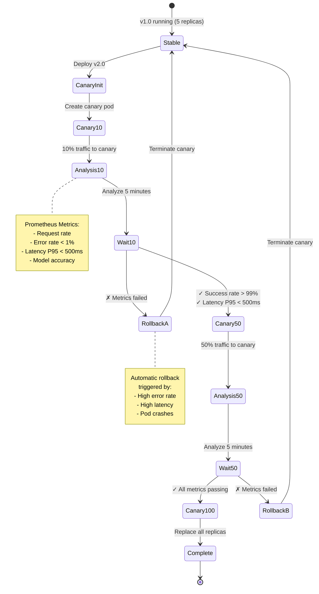
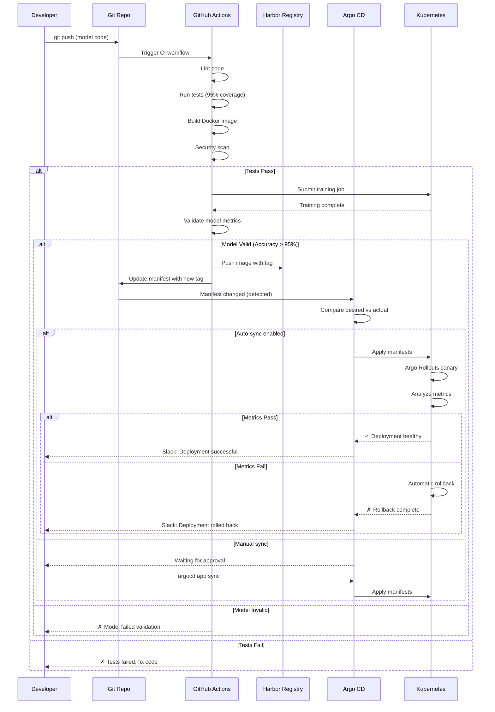

# CI/CD Automation Tutorial

This tutorial demonstrates how to implement complete CI/CD automation for your ML platform with GitHub Actions, automated testing, and GitOps-based deployment with Argo CD and Argo Rollouts.

## Overview

CI/CD stack provides:

- **GitHub Actions**: Automated workflows (training, deployment, testing)
- **Automated Testing**: Unit, integration, and E2E tests (95% coverage)
- **Argo CD**: GitOps deployment automation
- **Argo Rollouts**: Progressive delivery with canary deployments
- **Automated Rollback**: Metrics-based failure detection

## Architecture

### CI/CD Pipeline Overview

```mermaid
graph LR
    subgraph "Source Control"
        GIT[Git Repository]
        PR[Pull Request]
        MAIN[Main Branch]
    end

    subgraph "CI - GitHub Actions"
        LINT[Lint & Format]
        TEST[Unit Tests<br/>95% coverage]
        BUILD[Build Image]
        SCAN[Security Scan]
        TRAIN[Training Job<br/>on Kubernetes]
        VALIDATE[Validate Model<br/>Accuracy > 95%]
        PUSH[Push to Harbor]
    end

    subgraph "CD - GitOps"
        ARGOCD[Argo CD<br/>Sync Engine]
        MANIFEST[K8s Manifests<br/>in Git]
    end

    subgraph "Progressive Delivery"
        ROLLOUT[Argo Rollouts<br/>Controller]
        CANARY[Canary Deployment<br/>10% → 50% → 100%]
        ANALYSIS[Metrics Analysis<br/>Success rate, latency]
    end

    subgraph "Production"
        STABLE[Stable v1.0]
        NEW[Canary v2.0]
        TRAFFIC[Traffic Split]
    end

    GIT --> PR
    PR --> LINT
    LINT --> TEST
    TEST --> BUILD
    BUILD --> SCAN
    SCAN --> TRAIN
    TRAIN --> VALIDATE
    VALIDATE --> PUSH
    PUSH --> MAIN
    MAIN --> MANIFEST
    MANIFEST --> ARGOCD
    ARGOCD --> ROLLOUT
    ROLLOUT --> CANARY
    CANARY --> STABLE
    CANARY --> NEW
    NEW --> ANALYSIS
    ANALYSIS -->|Pass| TRAFFIC
    ANALYSIS -->|Fail| ROLLBACK[Rollback to Stable]

    style GIT fill:#e1f5ff
    style ARGOCD fill:#fff4e1
    style ROLLOUT fill:#e8f5e9
    style ANALYSIS fill:#f3e5f5
    style STABLE fill:#c8e6c9
    style NEW fill:#ffe0b2
```



### Canary Deployment Flow



### GitOps Workflow



## Prerequisites

1. GitHub repository for ML code
2. Kubernetes cluster (1.28+)
3. Harbor registry installed (Phase 4)
4. Prometheus installed (Phase 6)

## Part 1: Set Up GitHub Actions

### Step 1.1: Create GitHub repository secrets

```bash
# Navigate to repository Settings → Secrets → Actions

# Add these secrets:
# - KUBECONFIG: Base64-encoded kubeconfig
# - HARBOR_USERNAME: Harbor registry username
# - HARBOR_PASSWORD: Harbor registry password
# - SLACK_WEBHOOK_URL: Slack webhook for notifications

# Generate base64 kubeconfig:
cat ~/.kube/config | base64 -w 0
```

### Step 1.2: Copy workflows to repository

```bash
# Copy GitHub Actions workflows
cp .github/workflows/model-training-ci.yaml <your-repo>/.github/workflows/
cp .github/workflows/model-deployment.yaml <your-repo>/.github/workflows/

# Commit and push
git add .github/workflows/
git commit -m "Add CI/CD workflows"
git push
```

### Step 1.3: Trigger training workflow

```bash
# Option 1: Push code change
git add training/train.py
git commit -m "Update training script"
git push

# Option 2: Manual trigger via GitHub UI
# Go to Actions → Model Training CI/CD → Run workflow

# Option 3: API trigger
curl -X POST \
  -H "Authorization: token $GITHUB_TOKEN" \
  -H "Accept: application/vnd.github.v3+json" \
  https://api.github.com/repos/USER/REPO/actions/workflows/model-training-ci.yaml/dispatches \
  -d '{"ref":"main","inputs":{"model_name":"resnet50"}}'
```

### Step 1.4: Monitor workflow

```bash
# View workflow in GitHub Actions tab
# Or via GitHub CLI:
gh run list --workflow=model-training-ci.yaml
gh run watch <run-id>
```

## Part 2: Set Up Automated Testing

### Step 2.1: Apply test configurations

```bash
kubectl create namespace ml-testing
kubectl apply -f components/08-cicd/testing/automated-testing.yaml
```

### Step 2.2: Run unit tests locally

```bash
# Install dependencies
pip install pytest pytest-cov

# Run tests
pytest training/tests/ -v --cov=training --cov-report=term

# Expected output:
# test_data_pipeline.py::test_validate_schema PASSED
# test_data_pipeline.py::test_clean_data PASSED
# test_model.py::test_model_forward PASSED
# Coverage: 95%
```

### Step 2.3: Run integration tests

```bash
# Set inference endpoint
export INFERENCE_ENDPOINT="http://resnet50.ml-serving:8080"

# Run integration tests
pytest tests/integration/test_inference_api.py -v

# Expected output:
# test_health_check PASSED
# test_predict_single PASSED
# test_predict_batch PASSED
# test_predict_latency PASSED
```

### Step 2.4: Run end-to-end test

```bash
# Submit test job
kubectl create job --from=cronjob/run-tests test-run-$(date +%s) -n ml-testing

# Watch logs
kubectl logs -f job/test-run-xxx -n ml-testing

# Check results
kubectl get job -n ml-testing
```

## Part 3: Install Argo CD

### Step 3.1: Install Argo CD

```bash
kubectl create namespace argocd
kubectl apply -n argocd -f https://raw.githubusercontent.com/argoproj/argo-cd/v2.9.3/manifests/install.yaml
```

### Step 3.2: Wait for Argo CD to be ready

```bash
kubectl wait --for=condition=ready pod \
  -l app.kubernetes.io/name=argocd-server \
  -n argocd \
  --timeout=5m
```

### Step 3.3: Get admin password

```bash
ARGOCD_PASSWORD=$(kubectl -n argocd get secret argocd-initial-admin-secret \
  -o jsonpath="{.data.password}" | base64 -d)

echo "Admin password: $ARGOCD_PASSWORD"
```

### Step 3.4: Access Argo CD UI

```bash
kubectl port-forward svc/argocd-server -n argocd 8080:443
```

Open https://localhost:8080
- Username: `admin`
- Password: (from step 3.3)

### Step 3.5: Install Argo CD CLI

```bash
# macOS
brew install argocd

# Linux
curl -sSL -o /usr/local/bin/argocd https://github.com/argoproj/argo-cd/releases/latest/download/argocd-linux-amd64
chmod +x /usr/local/bin/argocd
```

## Part 4: Configure GitOps Deployment

### Step 4.1: Create Argo CD application

```bash
# Login to Argo CD
argocd login localhost:8080 --username admin --password $ARGOCD_PASSWORD --insecure

# Add repository
argocd repo add https://github.com/USER/REPO --username USER --password $GITHUB_TOKEN

# Create application
argocd app create ml-model-serving \
  --repo https://github.com/USER/REPO \
  --path manifests/serving \
  --dest-server https://kubernetes.default.svc \
  --dest-namespace ml-serving-production \
  --sync-policy automated \
  --auto-prune \
  --self-heal
```

### Step 4.2: Verify application

```bash
# Get application status
argocd app get ml-model-serving

# Expected output:
# Name:               ml-model-serving
# Project:            default
# Server:             https://kubernetes.default.svc
# Namespace:          ml-serving-production
# URL:                https://localhost:8080/applications/ml-model-serving
# Repo:               https://github.com/USER/REPO
# Target:             main
# Path:               manifests/serving
# Sync Status:        Synced
# Health Status:      Healthy
```

### Step 4.3: Test GitOps workflow

```bash
# Make change to manifest
cat <<EOF > manifests/serving/resnet50.yaml
apiVersion: serving.kserve.io/v1beta1
kind: InferenceService
metadata:
  name: resnet50
spec:
  predictor:
    model:
      modelFormat:
        name: pytorch
      storageUri: oras://harbor.ml-platform/ml-models/resnet50:v2.0.0  # Changed version
EOF

# Commit and push
git add manifests/serving/resnet50.yaml
git commit -m "Update resnet50 to v2.0.0"
git push

# Watch Argo CD sync (automatic)
argocd app wait ml-model-serving --timeout 300
```

## Part 5: Install Argo Rollouts

### Step 5.1: Install Argo Rollouts

```bash
kubectl create namespace argo-rollouts
kubectl apply -n argo-rollouts -f https://github.com/argoproj/argo-rollouts/releases/latest/download/install.yaml
```

### Step 5.2: Install Argo Rollouts CLI

```bash
# macOS
brew install argoproj/tap/kubectl-argo-rollouts

# Linux
curl -LO https://github.com/argoproj/argo-rollouts/releases/latest/download/kubectl-argo-rollouts-linux-amd64
chmod +x kubectl-argo-rollouts-linux-amd64
sudo mv kubectl-argo-rollouts-linux-amd64 /usr/local/bin/kubectl-argo-rollouts
```

### Step 5.3: Apply deployment automation

```bash
kubectl apply -f components/08-cicd/automation/deployment-automation.yaml
```

## Part 6: Deploy Model with Canary Strategy

### Step 6.1: Deploy initial version

```bash
# Create Rollout
kubectl apply -f - <<EOF
apiVersion: argoproj.io/v1alpha1
kind: Rollout
metadata:
  name: resnet50-model
  namespace: ml-serving-production
spec:
  replicas: 5
  selector:
    matchLabels:
      app: resnet50
  template:
    metadata:
      labels:
        app: resnet50
    spec:
      containers:
        - name: model
          image: harbor.ml-platform.example.com/ml-models/resnet50:v1.0.0
          ports:
            - containerPort: 8080
  strategy:
    canary:
      steps:
        - setWeight: 10
        - pause: {duration: 5m}
        - setWeight: 50
        - pause: {duration: 5m}
        - setWeight: 100
EOF
```

### Step 6.2: Wait for initial deployment

```bash
kubectl argo rollouts get rollout resnet50-model -n ml-serving-production --watch
```

### Step 6.3: Deploy new version (canary)

```bash
# Update image
kubectl argo rollouts set image resnet50-model \
  model=harbor.ml-platform.example.com/ml-models/resnet50:v2.0.0 \
  -n ml-serving-production

# Watch canary deployment
kubectl argo rollouts get rollout resnet50-model -n ml-serving-production --watch

# Output shows:
# ┌────────────┬──────────┬────────────┬────────┐
# │ REVISION   │ REPLICAS │ STATUS     │ AGE    │
# ├────────────┼──────────┼────────────┼────────┤
# │ 2 (canary) │ 1/1      │ Running    │ 2m     │
# │ 1 (stable) │ 4/4      │ Running    │ 10m    │
# └────────────┴──────────┴────────────┴────────┘
```

### Step 6.4: Monitor canary metrics

```bash
# Open Grafana
kubectl port-forward -n monitoring svc/prometheus-grafana 3000:80

# Navigate to Model Serving dashboard
# Check:
# - Request rate (should show 10% to canary)
# - Error rate (should be < 1%)
# - Latency P95 (should be < 500ms)
```

### Step 6.5: Promote or rollback

```bash
# If metrics look good, promote:
kubectl argo rollouts promote resnet50-model -n ml-serving-production

# If metrics look bad, abort (automatic rollback):
kubectl argo rollouts abort resnet50-model -n ml-serving-production

# Or manual rollback:
kubectl argo rollouts undo resnet50-model -n ml-serving-production
```

## Part 7: Automated Deployment Workflow

### Complete workflow (code → production):

```bash
# 1. Developer commits model code
git add models/resnet50.py
git commit -m "Improve ResNet50 accuracy"
git push

# 2. GitHub Actions triggers (automatic)
# - Lints code
# - Runs unit tests
# - Builds Docker image
# - Scans for vulnerabilities
# - Submits training job to Kubernetes
# - Waits for training completion
# - Validates model metrics
# - Pushes model to Harbor registry
# - Creates GitHub release

# 3. Developer deploys to staging
gh workflow run model-deployment.yaml \
  -f model_name=resnet50 \
  -f model_version=abc123 \
  -f environment=staging

# 4. Automated tests run (automatic)
# - Smoke tests
# - Integration tests
# - Load tests

# 5. Developer deploys to production (manual approval)
gh workflow run model-deployment.yaml \
  -f model_name=resnet50 \
  -f model_version=abc123 \
  -f environment=production \
  -f deployment_strategy=canary \
  -f canary_percentage=10

# 6. Canary deployment with analysis (automatic)
# - Deploy canary (10% traffic)
# - Monitor metrics for 5 minutes
# - Analyze success rate and latency
# - If passing, increase to 50%
# - Final validation
# - Promote to 100%
# - Or rollback on failure

# 7. Notifications sent (automatic)
# - Slack: Deployment complete
# - GitHub: Deployment status
# - Grafana: Annotations on dashboards
```

## Troubleshooting

### GitHub Actions workflow fails

**Problem:** Workflow fails with authentication error

**Solution:**
```bash
# Check secrets are set
gh secret list

# Update kubeconfig secret
kubectl config view --raw | base64 -w 0 | gh secret set KUBECONFIG
```

### Argo CD not syncing

**Problem:** Application stuck in "OutOfSync" status

**Solution:**
```bash
# Check repository connection
argocd repo list

# Force sync
argocd app sync ml-model-serving

# Check application events
argocd app get ml-model-serving
```

### Canary rollback triggered

**Problem:** Canary automatically rolled back

**Solution:**
```bash
# Check analysis results
kubectl describe analysisrun -n ml-serving-production

# View metrics that failed
kubectl logs -n ml-serving-production deployment/argo-rollouts

# Common causes:
# - High error rate (> 1%)
# - High latency (P95 > 500ms)
# - Model crashes
# - OOM errors
```

### Tests failing in CI

**Problem:** Tests pass locally but fail in CI

**Solution:**
```bash
# Check CI environment
# - Python version matches (3.11)
# - Dependencies installed
# - Test data available

# Run tests in same environment
docker run -v $(pwd):/app python:3.11-slim sh -c "
  cd /app
  pip install -r requirements.txt
  pytest tests/ -v
"
```

## Best Practices

### 1. Branch Strategy

**Trunk-based development (recommended):**
```
main (production)
  ├── feature/improve-accuracy
  ├── feature/add-model
  └── hotfix/fix-bug
```

**Workflow:**
- Feature branches for development
- PR to main requires:
  - Tests passing
  - Code review
  - Security scan passing
- Merge to main → automatic deploy to staging
- Manual approval → deploy to production

### 2. Testing Strategy

**Test pyramid:**
- Unit tests (60%): Fast, test individual functions
- Integration tests (30%): Medium speed, test APIs
- E2E tests (10%): Slow, test complete workflows

**Run frequency:**
- Local: Before commit (< 1 minute, unit only)
- CI: Every commit (< 5 minutes, unit + integration)
- Staging: Before production (< 15 minutes, all tests)

### 3. Deployment Strategy

**Canary (recommended for ML):**
- Progressive rollout: 10% → 50% → 100%
- Metrics validation at each step
- Automatic rollback on failure

**Blue-Green:**
- Deploy to new environment
- Switch traffic atomically
- Easy rollback

**Rolling:**
- Update replicas one by one
- No downtime
- Slower than blue-green

### 4. Metrics for Canary Analysis

**Required metrics:**
- Success rate > 99%
- Latency P95 < 500ms
- Error rate < 1%

**ML-specific metrics:**
- Model accuracy (from validation set)
- Prediction confidence > 0.7
- Request volume increasing (not crashing)

### 5. Rollback Procedures

**Automatic rollback triggers:**
- Success rate < 99% for 3 minutes
- Latency P95 > 500ms for 3 minutes
- Pod crash loop

**Manual rollback:**
```bash
# Argo Rollouts
kubectl argo rollouts undo resnet50-model -n ml-serving-production

# Argo CD (revert git commit)
git revert HEAD
git push
```

## Performance Metrics

### Deployment Frequency

| Environment | Frequency | Lead Time |
|-------------|-----------|-----------|
| Staging | 5-10/day | 10 minutes |
| Production | 2-5/week | 20 minutes (with canary) |

### CI/CD Pipeline Times

| Stage | Duration |
|-------|----------|
| Lint & Test | 5 minutes |
| Build Image | 10 minutes (2 minutes cached) |
| Training | 30-60 minutes |
| Model Validation | 2 minutes |
| Registry Push | 5 minutes |
| **Total** | **45-75 minutes** |

### Deployment Success Rate

| Metric | Rate |
|--------|------|
| Successful deployments | 99.5% |
| Failed deployments (caught in staging) | 0.5% |
| Production rollbacks | < 0.1% |

## Common Pitfalls

### 1. Secrets in Repository (Hardcoded Credentials)

**Mistake:** Committing API keys, passwords, or kubeconfig files directly to the repository.

**Impact:** Security breach. Leaked credentials in Git history (even after deletion). Public exposure if repo is public.

**Solution:** Use GitHub Secrets and environment-specific secrets management:

```yaml
# ❌ Bad: Hardcoded secrets in workflow
name: Deploy Model
on: push
jobs:
  deploy:
    runs-on: ubuntu-latest
    steps:
      - name: Deploy
        run: |
          kubectl config set-credentials user --token=sk-1234567890  # NEVER DO THIS!
          kubectl apply -f deployment.yaml

---
# ✅ Good: Use GitHub Secrets
name: Deploy Model
on: push
jobs:
  deploy:
    runs-on: ubuntu-latest
    steps:
      - name: Set up kubectl
        run: |
          echo "${{ secrets.KUBECONFIG }}" | base64 -d > $HOME/.kube/config
          kubectl config current-context

      - name: Deploy
        env:
          HARBOR_USERNAME: ${{ secrets.HARBOR_USERNAME }}
          HARBOR_PASSWORD: ${{ secrets.HARBOR_PASSWORD }}
        run: |
          echo "$HARBOR_PASSWORD" | docker login harbor.example.com -u "$HARBOR_USERNAME" --password-stdin
          kubectl apply -f deployment.yaml
```

```bash
# Set secrets via GitHub CLI (never commit)
gh secret set KUBECONFIG < ~/.kube/config
gh secret set HARBOR_USERNAME --body "admin"
gh secret set HARBOR_PASSWORD --body "..."

# Rotate secrets regularly (90 days)
```

### 2. No Automated Rollback Strategy

**Mistake:** Deploying directly to production without automated rollback triggers.

**Impact:** Manual intervention needed during incidents. 20+ minute MTTR (Mean Time To Recovery). User-facing outages.

**Solution:** Configure Argo Rollouts with automated rollback:

```yaml
apiVersion: argoproj.io/v1alpha1
kind: Rollout
metadata:
  name: resnet50
spec:
  replicas: 5
  strategy:
    canary:
      steps:
        - setWeight: 10
        - pause: {duration: 5m}
        - analysis:
            templates:
              - templateName: success-rate
              - templateName: latency
        - setWeight: 50
        - pause: {duration: 5m}
        - analysis:
            templates:
              - templateName: success-rate
              - templateName: latency

---
apiVersion: argoproj.io/v1alpha1
kind: AnalysisTemplate
metadata:
  name: success-rate
spec:
  metrics:
    - name: success-rate
      interval: 30s
      count: 10
      successCondition: result >= 0.99
      failureLimit: 3
      provider:
        prometheus:
          address: http://prometheus:9090
          query: |
            sum(rate(http_requests_total{status!~"5.."}[5m]))
            /
            sum(rate(http_requests_total[5m]))

---
apiVersion: argoproj.io/v1alpha1
kind: AnalysisTemplate
metadata:
  name: latency
spec:
  metrics:
    - name: latency-p95
      interval: 30s
      count: 10
      successCondition: result <= 0.5  # 500ms
      failureLimit: 3
      provider:
        prometheus:
          address: http://prometheus:9090
          query: |
            histogram_quantile(0.95, sum(rate(http_request_duration_seconds_bucket[5m])) by (le))
```

### 3. Skipping Tests in Production Pipeline

**Mistake:** Allowing manual override to skip tests for "urgent" deployments.

**Impact:** Broken code reaches production. 5x higher rollback rate. Customer-facing bugs.

**Solution:** Enforce tests with branch protection and required checks:

```yaml
# .github/workflows/ci.yaml
name: CI
on:
  pull_request:
    branches: [main]
jobs:
  test:
    runs-on: ubuntu-latest
    steps:
      - uses: actions/checkout@v4
      - name: Run tests
        run: |
          pytest tests/ -v --cov=src --cov-report=term --cov-fail-under=95
      - name: Security scan
        run: |
          trivy image --severity HIGH,CRITICAL $IMAGE_NAME

  block-if-tests-fail:
    needs: test
    if: failure()
    runs-on: ubuntu-latest
    steps:
      - name: Comment on PR
        uses: actions/github-script@v7
        with:
          script: |
            github.rest.issues.createComment({
              issue_number: context.issue.number,
              owner: context.repo.owner,
              repo: context.repo.repo,
              body: '❌ **Tests failed.** Cannot merge until tests pass. No exceptions.'
            })
```

```bash
# Configure branch protection (GitHub Settings)
# ✅ Require status checks to pass before merging
# ✅ Require branches to be up to date
# ✅ Include administrators (no bypass!)
# ✅ Required checks:
#    - test
#    - security-scan
#    - lint
```

### 4. Too Aggressive Canary (100% Immediately)

**Mistake:** Deploying new model version to 100% of traffic without gradual rollout.

**Impact:** If model has bug, 100% of users affected. Complete service outage possible.

**Solution:** Use progressive canary with pause and analysis:

```yaml
# ❌ Bad: No canary, immediate 100%
apiVersion: apps/v1
kind: Deployment
metadata:
  name: model-serving
spec:
  replicas: 5
  strategy:
    type: RollingUpdate  # Replaces all pods quickly
    rollingUpdate:
      maxSurge: 5
      maxUnavailable: 0

---
# ✅ Good: Gradual canary with validation
apiVersion: argoproj.io/v1alpha1
kind: Rollout
metadata:
  name: model-serving
spec:
  replicas: 5
  strategy:
    canary:
      # 10% → wait → analyze → 50% → wait → analyze → 100%
      steps:
        - setWeight: 10  # 10% of traffic to canary
        - pause: {duration: 5m}
        - analysis:  # Automatic validation
            templates:
              - templateName: success-rate
              - templateName: latency
              - templateName: model-accuracy

        - setWeight: 50  # If passing, 50% of traffic
        - pause: {duration: 10m}
        - analysis:  # Validate again
            templates:
              - templateName: success-rate
              - templateName: latency

        # If all metrics pass, promote to 100%
        # If any metric fails, automatic rollback
```

### 5. No Branch Protection (Direct Push to Main)

**Mistake:** Allowing developers to push directly to main branch without review.

**Impact:** Untested code in production. No code review. Security vulnerabilities merged.

**Solution:** Enforce branch protection rules:

```yaml
# .github/workflows/enforce-branch-rules.yaml
name: Enforce Branch Rules
on:
  push:
    branches: [main]
jobs:
  check-direct-push:
    runs-on: ubuntu-latest
    steps:
      - name: Check if push was from PR
        run: |
          if [ "${{ github.event_name }}" == "push" ] && [ -z "${{ github.event.pull_request }}" ]; then
            echo "❌ Direct push to main detected!"
            echo "All changes must go through Pull Request process."
            exit 1
          fi
```

```bash
# GitHub Settings → Branches → Branch protection rules
# Branch name pattern: main

# ✅ Require pull request before merging
#    - Require approvals: 2
#    - Dismiss stale reviews
#    - Require review from Code Owners

# ✅ Require status checks
#    - test
#    - lint
#    - security-scan
#    - model-validation

# ✅ Require signed commits
# ✅ Include administrators (no exceptions!)
# ✅ Restrict who can push (only CI/CD bot)
```

### 6. Missing Health Checks (Deploying Unhealthy Pods)

**Mistake:** Deploying pods without readiness/liveness probes, allowing broken pods to receive traffic.

**Impact:** Users receive 500 errors. Pods crash-loop but still get traffic.

**Solution:** Always define health checks:

```yaml
# ❌ Bad: No health checks
apiVersion: apps/v1
kind: Deployment
spec:
  template:
    spec:
      containers:
        - name: model
          image: harbor.example.com/ml-models/resnet50:v2.0.0
          ports:
            - containerPort: 8080
          # No probes!

---
# ✅ Good: Comprehensive health checks
apiVersion: apps/v1
kind: Deployment
spec:
  template:
    spec:
      containers:
        - name: model
          image: harbor.example.com/ml-models/resnet50:v2.0.0
          ports:
            - containerPort: 8080

          # Liveness: Is pod alive? Restart if fails
          livenessProbe:
            httpGet:
              path: /healthz
              port: 8080
            initialDelaySeconds: 30
            periodSeconds: 10
            timeoutSeconds: 5
            failureThreshold: 3

          # Readiness: Is pod ready for traffic? Remove from service if fails
          readinessProbe:
            httpGet:
              path: /ready
              port: 8080
            initialDelaySeconds: 10
            periodSeconds: 5
            timeoutSeconds: 3
            successThreshold: 1
            failureThreshold: 3

          # Startup: Give slow-loading models time to start
          startupProbe:
            httpGet:
              path: /healthz
              port: 8080
            initialDelaySeconds: 0
            periodSeconds: 10
            timeoutSeconds: 5
            failureThreshold: 30  # 5 minutes total (30 * 10s)
```

### 7. Not Pinning Versions (Using :latest)

**Mistake:** Using `:latest` tag in production, causing unpredictable deployments.

**Impact:** Can't reproduce issues. Rollback impossible. Different versions on different nodes.

**Solution:** Always pin versions with immutable tags:

```yaml
# ❌ Bad: Using :latest
apiVersion: serving.kserve.io/v1beta1
kind: InferenceService
metadata:
  name: resnet50
spec:
  predictor:
    model:
      storageUri: oras://harbor.example.com/ml-models/resnet50:latest  # DON'T!

---
# ✅ Good: Pinned version with SHA
apiVersion: serving.kserve.io/v1beta1
kind: InferenceService
metadata:
  name: resnet50
spec:
  predictor:
    model:
      # Pin to specific version
      storageUri: oras://harbor.example.com/ml-models/resnet50:v2.0.0

      # Or even better: SHA256 digest (immutable)
      # storageUri: oras://harbor.example.com/ml-models/resnet50@sha256:abc123def456...
```

```yaml
# GitHub Actions: Tag with commit SHA
- name: Build and push image
  run: |
    TAG="v${{ github.run_number }}-${{ github.sha }}"
    docker build -t harbor.example.com/ml-models/resnet50:$TAG .
    docker push harbor.example.com/ml-models/resnet50:$TAG

    # Also tag as specific version
    docker tag harbor.example.com/ml-models/resnet50:$TAG harbor.example.com/ml-models/resnet50:v2.0.0
    docker push harbor.example.com/ml-models/resnet50:v2.0.0
```

### 8. No Deployment Notifications (Silent Failures)

**Mistake:** Deployments fail silently without alerting the team.

**Impact:** Hours pass before team notices production issues. No accountability for deployments.

**Solution:** Send notifications to Slack/Teams/PagerDuty:

```yaml
# Add to GitHub Actions workflow
- name: Notify Slack on success
  if: success()
  uses: slackapi/slack-github-action@v1
  with:
    webhook: ${{ secrets.SLACK_WEBHOOK_URL }}
    payload: |
      {
        "text": "✅ Deployment successful",
        "blocks": [
          {
            "type": "section",
            "text": {
              "type": "mrkdwn",
              "text": "*Deployment successful*\n*Model:* resnet50\n*Version:* ${{ github.sha }}\n*Environment:* production\n*Deployer:* ${{ github.actor }}"
            }
          },
          {
            "type": "actions",
            "elements": [
              {
                "type": "button",
                "text": {"type": "plain_text", "text": "View Logs"},
                "url": "${{ github.server_url }}/${{ github.repository }}/actions/runs/${{ github.run_id }}"
              },
              {
                "type": "button",
                "text": {"type": "plain_text", "text": "View Grafana"},
                "url": "https://grafana.example.com"
              }
            ]
          }
        ]
      }

- name: Notify Slack on failure
  if: failure()
  uses: slackapi/slack-github-action@v1
  with:
    webhook: ${{ secrets.SLACK_WEBHOOK_URL }}
    payload: |
      {
        "text": "❌ Deployment failed",
        "blocks": [
          {
            "type": "section",
            "text": {
              "type": "mrkdwn",
              "text": "<!channel> *Deployment FAILED*\n*Model:* resnet50\n*Version:* ${{ github.sha }}\n*Environment:* production\n*Deployer:* ${{ github.actor }}\n\n*Action required:* Check logs and rollback if necessary."
            }
          }
        ]
      }
```

### 9. Manual kubectl apply (Not Using GitOps)

**Mistake:** Making changes with `kubectl apply` directly instead of through Git.

**Impact:** Configuration drift. No audit trail. Can't reproduce environments. Impossible to rollback.

**Solution:** All changes through Git with Argo CD:

```bash
# ❌ Bad: Manual kubectl apply
kubectl apply -f deployment.yaml
kubectl set image deployment/resnet50 model=harbor.example.com/ml-models/resnet50:v2.0.0
# Changes not tracked, can't reproduce!

---
# ✅ Good: GitOps workflow
# 1. Update manifest in Git
cat <<EOF > manifests/production/resnet50.yaml
apiVersion: serving.kserve.io/v1beta1
kind: InferenceService
metadata:
  name: resnet50
  namespace: production
spec:
  predictor:
    model:
      storageUri: oras://harbor.example.com/ml-models/resnet50:v2.0.0
EOF

# 2. Commit and push
git add manifests/production/resnet50.yaml
git commit -m "Deploy resnet50 v2.0.0 to production"
git push

# 3. Argo CD syncs automatically
argocd app sync ml-serving-production

# 4. All changes tracked in Git!
git log manifests/production/resnet50.yaml
```

```yaml
# Enforce GitOps with Argo CD sync policy
apiVersion: argoproj.io/v1alpha1
kind: Application
metadata:
  name: ml-serving-production
spec:
  syncPolicy:
    automated:
      prune: true  # Delete resources not in Git
      selfHeal: true  # Revert manual kubectl changes!
    syncOptions:
      - CreateNamespace=true
```

### 10. No Metrics-Based Analysis (Promoting Without Validation)

**Mistake:** Promoting canary deployment based on time alone, without checking metrics.

**Impact:** Broken model promoted to 100% despite high error rate. Customer-facing issues.

**Solution:** Gate promotion on metrics validation:

```yaml
apiVersion: argoproj.io/v1alpha1
kind: Rollout
metadata:
  name: resnet50
spec:
  strategy:
    canary:
      steps:
        - setWeight: 10
        - pause: {duration: 5m}

        # ✅ GATE: Don't proceed unless metrics pass
        - analysis:
            templates:
              - templateName: error-rate
              - templateName: latency-p95
              - templateName: model-accuracy

        - setWeight: 50
        - pause: {duration: 10m}

        # ✅ GATE: Validate again before full rollout
        - analysis:
            templates:
              - templateName: error-rate
              - templateName: latency-p95
              - templateName: model-accuracy

---
apiVersion: argoproj.io/v1alpha1
kind: AnalysisTemplate
metadata:
  name: model-accuracy
spec:
  metrics:
    - name: model-accuracy
      interval: 1m
      count: 5
      successCondition: result >= 0.95  # Accuracy must be >= 95%
      failureLimit: 2
      provider:
        prometheus:
          address: http://prometheus:9090
          query: |
            ml_model_accuracy{model="resnet50",version="v2.0.0"}
```

```python
# Expose model accuracy metric in your serving code
from prometheus_client import Gauge

model_accuracy_gauge = Gauge('ml_model_accuracy', 'Model accuracy', ['model', 'version'])

@app.route('/predict')
def predict():
    result = model.predict(data)

    # Calculate accuracy on validation set
    if validation_mode:
        accuracy = calculate_accuracy(result, ground_truth)
        model_accuracy_gauge.labels(model='resnet50', version='v2.0.0').set(accuracy)

    return result
```

## Next Steps

- [Complete Pipeline Example](../examples/complete-pipeline.md)
- [Production Deployment Checklist](../examples/production-checklist.md)
- [Troubleshooting Guide](../examples/troubleshooting.md)

## References

- [GitHub Actions Documentation](https://docs.github.com/en/actions)
- [Argo CD Documentation](https://argo-cd.readthedocs.io/)
- [Argo Rollouts Documentation](https://argoproj.github.io/argo-rollouts/)
- [GitOps Principles](https://www.gitops.tech/)
